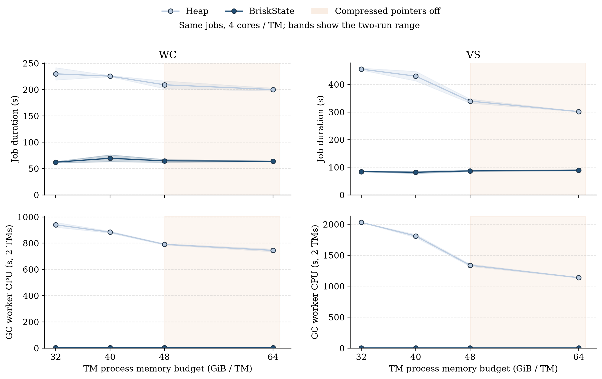
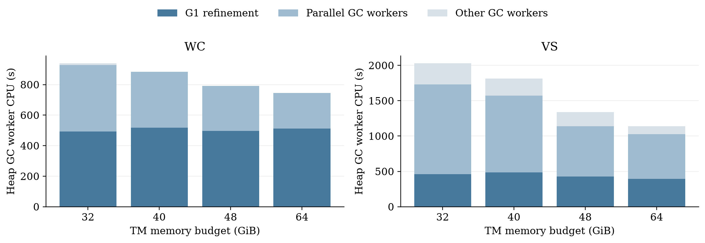
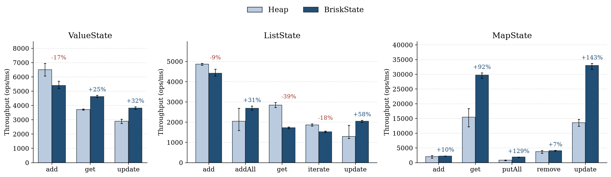
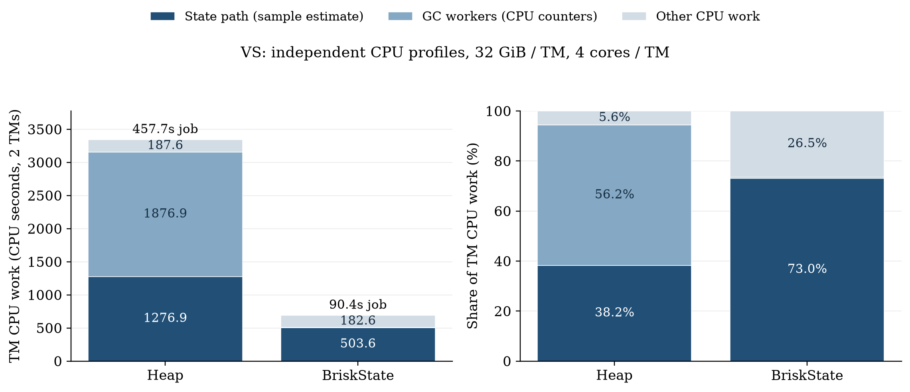

> 本报告为 R18 冻结测量。最新标准状态 API 优化见 [后续专项报告](BriskState_State_Access_Optimization_Report.md)。

# ForL0 优化、TM 内存梯度与状态微基准报告

完成日期：2026-11-04（Asia/Shanghai）。

环境：鲲鹏 920 ARM64、Flink 1.20.3、BiSheng OpenJDK 11、G1。正式性能实验关闭 L0 与 checkpoint。分支 `briskstate_workspace`；图中 BriskState 即 ForL0StateBackend。

## 主要结论

- **同为 32 GiB/TM 总预算、按后端合理分配内存**：WC 的 Heap / ForL0 为 238.90 / 62.24 秒，ForL0 快 **3.84×**。两后端各两次；Heap 已将不使用的 8 GiB task off-heap 转给 Java 堆。
- **同为 32 GiB/TM 总预算、按后端合理分配内存**：VS 的 Heap / ForL0 为 443.00 / 84.37 秒，ForL0 快 **5.25×**。两后端各两次；Heap 已将不使用的 8 GiB task off-heap 转给 Java 堆。
- 增大内存确实帮助 Heap：WC 从 32 到 64 GiB/TM，耗时降低 13.0%；64 GiB 点 ForL0 仍快 3.13×。
- 增大内存确实帮助 Heap：VS 从 32 到 64 GiB/TM，耗时降低 33.7%；64 GiB 点 ForL0 仍快 3.37×。
- 保留整数 hash 混合、按状态选择的连续 Long 列表、延迟装箱与 Java 写缓冲复用、删除 Long 列表没有使用者的 epoch 写入，以及分配更少的静态迭代器。Map 的 boxed 值缓存、热方法重排和没有稳定边际收益的 Java 特化均未合入。
- 最后保留的 Long 构造改动，使本次立即拆箱的微基准中 List 遍历少 384 B/op、Map/Value get 少 24 B/op。效果依赖调用上下文，不能推导整个 job 零分配。

以下把整作业、内存敏感性、单 API 微基准和 profiler 诊断分别列出；每个结论对应实际测量。

## 1. 公平性与共同 workload

整作业两后端运行同一个固定 JAR、相同源数据、拓扑、并行度、状态描述符和标准 Flink API。job 通过 `ValueState.value/update` 与 `MapState.get/put` 访问状态，由 Flink 配置选择后端。没有在 job 中判断后端类型、探测能力或调用扩展方法。

WC 输入 48M、VS 输入 3M；普通有状态角色使用 524288 个实体 key、每 key 64 个 Long feature，每次输入执行 128 对 get/put（遍历两轮）。每次增量为 1,000,000,007，避免 Long 小值缓存。VS 的 GlobalACD 保留单全局任务，width=4、touches=1。沿用[ICDE17 Figure 5](https://www.comp.nus.edu.sg/~hebs/pub/shuhaoICDE17a.pdf) 的数值适配任务框架；这是压力负载，不是原论文完整业务算法与数据集的复现。

reproduction/benchset-source 保存实测 JAR 的冻结源码。它与当前仓库只在默认参数和两行注释上不同；本轮所有命令显式指定 records/touches 等参数，实际执行逻辑与增量常数一致，见 reproduction/provenance.json。

1 JM 固定 4 核、8 GiB；2 TM 各 4 核、4 slots。JVM 启动前 taskset：JM CPU 0–3、TM CPU 4–7 / 8–11，并设置 ActiveProcessorCount=4。C++ 引擎在 TM 的 JNI 线程内执行，GC/JIT/native 线程继承亲和性。逐线程记录未发现越界时，才能把该次测量纳入公平结果。taskset 不提供核心独占，宿主机仍有其他负载。

TM process memory 是 [Flink 的内存预算配置](https://nightlies.apache.org/flink/flink-docs-release-1.20/docs/deployment/memory/mem_setup_tm/)，并非 OS 对每 TM 的硬 RSS 限制。本报告同时记录实际 Xmx、GC 选项和 RSS。父容器上限为 192 GiB、32 CPU 配额；最高测试点为 2×64 GiB TM +8 GiB JM，留有容器余量。

## 2. 有效优化及淘汰的候选

本轮从 R4 继续优化。此前已实现的 primitive ValueState、密集 MapState 连续存储与后端内部直接访问仍是整作业优势的重要基础：相同标准 API 在 ForL0 内部选择快路径，Heap 由官方 HeapMapState 执行。Heap 本身也不为每次 Map get/put 序列化值，因此这里的优势不能解释为省去了 Heap 的逐值序列化。本节新增优化的增量用独立 A/B 结果说明，不把全部跨后端倍数归到本轮 hash 或 List 改动。

### 2.1 主要热点：整数 hash 在 SwissTable 中聚集

原表默认使用 std::hash<int64_t>；当前 libstdc++ 对整数基本采用原值。表再用 H1=hash>>7、H2=hash&127，因此连续小整数的探测起点集中。新的默认整数 hash 先进行 64 位混合，再按原 H1/H2 规则查表。它改变后端内部桶分布，Flink 的 key-group 分配和 job 数据均保持一致。Swiss table 需要全比特空间的良好混合，见 [Abseil 官方设计说明](https://abseil.io/about/design/swisstables)。

独立 C++ 诊断使用真实 SwissTable、262144 个连续 Long key、524288 槽位及相同乱序查询。计时使用普通比较器，比较次数在另一遍计数，二者分开。

| hash | 不同探测起点数 | 同起点最多 key | 每命中等值比较次数 | lookup ns |
| --- | --- | --- | --- | --- |
| identity | 2048 | 128 | 15.7119 | 811.121 |
| mixed | 206249 | 6 | 1.00399 | 25.2253 |

这个单表诊断确认了聚集与探测成本。Flink 每个 key-group 有自己的表：端到端默认分组较多，JMH 此处使用两个 key-group，聚集程度不同；整作业收益使用 Flink 实测，单表倍数不作为整作业加速比。

### 2.2 Long ListState

原生 Long 列表原来仍将每个元素保存成 8 字节字符串。最终版在注册时识别 Long 元素与 VoidNamespace，选择 vector<int64_t>；通用列表保持原表示。JNI 直接复制 long 区域；原生更新复用容器、Java 批量写复用 long[]。get 返回持有复制后 long[] 的 Iterable，遍历时按需装箱。只有复制的数组返回 Java，Long 列表不暴露直接写视图，因此删除该类型无使用者的 epoch 更新；Map 的视图失效机制保留。

中途的逐行 variant 封装使单条追加回退，已改为按状态选择具体容器。新 checkpoint 编解码保持原有 length/count/long 字节格式，并通过真实的 COW 和格式往返检查；正式性能测量不触发 checkpoint。

| 独立 A/B 阶段 | add | addAll | get | iterate | update |
| --- | --- | --- | --- | --- | --- |
| R4→R8：Java 与临时容器 | +14.4% | +69.0% | +9.8% | +5.4% | +3.4% |
| R8→R13：整数 hash 混合 | +842.6% | +381.6% | +259.7% | +208.2% | +258.6% |
| R13→R14：按状态选择 Long 容器 | -7.1% | +29.0% | +20.7% | +15.7% | +39.7% |
| R14→R15：删除无用 epoch 写入 | +8.5% | +16.3% | — | — | +4.6% |

表中是吞吐变化；每阶段两次独立 fork，阶段内 JAR 与参数完全相同。R15 的独立增量对照只测三种写操作；读路径的最终实测见第 4 节。单条追加与批量读写存在取舍，所有结果与负收益均保留。

R16 将匿名 Long 迭代器改为直接持有 long[] 的静态迭代器，完整遍历少分配 16 B/op。R15→R16 的交错对照吞吐增加 3.5%（两个 fork/版本；另一次仅 iterate 的交错对照方向相同）。该诊断在 CPU 96–99 单独运行；最终图中的 List 五种操作已在与其他正式微基准相同的 CPU 4–7 上重新运行。它没有消除 16 个 Long 的逐元素装箱。

### 2.3 使临时 Long 包装可被 JIT 消除

在泛型返回位置使用显式 Long 构造，替换 valueOf 的缓存分支。当前 Java 11、值超出 Long 缓存、调用方立即拆箱的微基准上下文中，GC profiler 确认临时包装被消除。这是有测量依据的局部写法；Long 构造函数虽然已弃用，仍在这里有意使用。不将它推荐为通用 Java 风格，也不保证返回对象逃逸或小值负载同样获益。

| 交错 A/B 操作 | 前版 ops/ms | 后版 ops/ms | 变化 | Java B/op |
| --- | --- | --- | --- | --- |
| listIterate | 1360.5 | 1514.0 | +11.3% | 576.2 → 192.2 |
| mapGet | 26433.7 | 29943.1 | +13.3% | 72.0 → 48.0 |
| valueGet | 4361.0 | 4517.8 | +3.6% | 72.1 → 48.1 |

这些诊断绑定 CPU 96–99，每版两个独立 fork；最终图中受影响的三个读操作与 Map get 切换实体边界已在 CPU 4–7 重测。List 每遍历少 384 B，与 16×24 B 的 Long 临时包装相符；Map/Value 每读少 24 B。剩余约 48 B/op 来自共同 invocation fixture，不等于整个应用零分配。

| 同一 WC job 的控制版本 | 两次耗时 s | 均值 s |
| --- | --- | --- |
| r16 | 62.010 / 76.790 | 69.400 |
| r18 | 60.252 / 68.843 | 64.547 |

这组顺序为 R16→R18→R18→R16，JAR、48M 输入、CPU、32 GiB/TM 相同。共享主机的波动较大，不能把均值差直接描述为确定的整作业增益。保留依据是操作级分配与吞吐对照；最终端到端加速比采用后面的新版本 Heap/ForL0 同时段交错复测。

| 未保留候选 | 测量与决定 |
| --- | --- |
| R5：Map 热方法重排 | WC 约 2% 差异，与运行波动难以区分。 |
| R7：缓存 boxed Long | WC R4=60.825/60.953 s；R7=68.205/66.191 s，耗时增加约 10.4%。 |
| R10/R12：Map Java 类型特化 | 旧 hash 下约 9% 收益；与新 hash 合并后，R11=58.430/62.733 s、R12=63.004/58.355 s，均值约 60.58/60.68 s，没有稳定边际收益。 |
| 逐行 variant 列表 | 修正 hash 后，单条追加较未压缩列表回退约 22%；最终使用按状态选择的标准容器。 |

这里以可复测收益筛选实现；没有把减少分配、缩短代码或增加缓存本身当作性能提升。保留原生实现通过 142 项检查；最终 Java 通过 25 项配置/状态语义检查，其中包含一次真实 Long ListState snapshot→restore→继续追加，确保新容器在恢复注册入口也能正确选择。该正确性验证不计入性能数据。

## 3. TM 内存梯度

测试 32、40、48、64 GiB/TM；JM 始终 8 GiB。共同拆分固定 task off-heap=8 GiB、managed=256 MiB、network=512 MiB。每个点、每 workload、每后端两次，均新 JVM；不带 profiler，时间采用 Flink REST duration。

Heap 曲线使用最初冻结实现的 16 次运行，官方 Heap 实现与应用 JAR未改；ForL0 曲线使用最终版本的 16 次运行（32 GiB 取最终校准，其他点复测）。原始 R4 的完整扫描另保存在 memory/ 与 analysis/memory-r4.json。各阶段和实际后端二进制哈希均保留，避免把早期 ForL0 当作最终版。

ForL0 的全部内存点均已用最终 R18 重跑，32 GiB 点取最后的 Heap/ForL0 交错校准；最终 VS CPU profile 也重新采集了两后端。Heap 曲线沿用未改动的官方实现。早期 R16 的报告与分析另存为 REPORT-r16.md、analysis/*-r16.json。Heap 曲线与最终 ForL0 曲线采自不同时间段，CPU 未独占，适合判断数量级与趋势，不据此声称几个百分点的最优内存点。

| TM process GiB | Java heap GiB/TM | CompressedOops | CompressedClassPointers | G1 region MiB |
| --- | --- | --- | --- | --- |
| 32 | 21.875 | true | true | 8 |
| 40 | 29.875 | true | true | 8 |
| 48 | 37.875 | false | false | 16 |
| 64 | 53.875 | false | false | 16 |

48/64 GiB 点同时关闭压缩引用/类指针，并改变 G1 region。内存增加伴随 JVM 自动布局与 GC 决策变化，下面描述实际配置的敏感性，不把全部变化单独归因于 GC 容量。

| 独立 JVM 布局诊断 | Long 字节 | long[16] 字节 | Object[16] 字节 |
| --- | --- | --- | --- |
| 8g | 24 | 144 | 80 |
| 54g | 24 | 152 | 152 |

该诊断用独立 Java Instrumentation.getObjectSize 实测，不向 TM 注入 agent。两种布局下 Long 都为 24 字节；引用数组随压缩指针关闭变大，原生 int64 状态的元素宽度仍为 8 字节。记录见 memory-layout/results.json。

| workload | GiB/TM | Heap s（范围） | ForL0 s（范围） | H/F | GC CPU H/F s | GC 占减少 CPU |
| --- | --- | --- | --- | --- | --- | --- |
| WC | 32 | 229.97 (218.21–241.73) | 62.24 (61.07–63.41) | 3.69× | 940.4 / 2.74 | 69.7% |
| WC | 40 | 225.55 (224.45–226.66) | 69.61 (63.06–76.16) | 3.24× | 884.2 / 2.84 | 70.9% |
| WC | 48 | 209.19 (201.92–216.45) | 64.72 (61.94–67.50) | 3.23× | 791.2 / 2.83 | 67.3% |
| WC | 64 | 200.10 (197.32–202.88) | 63.90 (63.33–64.47) | 3.13× | 745.3 / 2.71 | 68.1% |
| VS | 32 | 455.38 (451.68–459.07) | 84.37 (83.86–84.89) | 5.40× | 2031.2 / 3.65 | 74.0% |
| VS | 40 | 430.06 (412.85–447.26) | 82.06 (77.81–86.31) | 5.24× | 1812.3 / 3.74 | 68.7% |
| VS | 48 | 339.59 (332.18–347.00) | 87.04 (84.83–89.26) | 3.90× | 1339.0 / 3.65 | 67.3% |
| VS | 64 | 301.73 (301.03–302.43) | 89.59 (87.68–91.51) | 3.37× | 1138.8 / 3.62 | 67.4% |



阴影误差带为两次范围；橙色标出本次测试中压缩指针关闭的点。GC CPU 是两 TM 的 GC 工作线程累计 CPU 秒，可以大于墙钟时间。



refinement、并行 GC、其余 GC 工作分开统计。更大的堆能改变回收频率和扫描成本，但状态对象引用更新产生的工作并不会自动按容量比例消失。

| workload | GiB/TM | 后端 | 两 TM STW 并集 s | 两 TM 平均使用核数 | 两 TM RSS 峰值之和 GiB |
| --- | --- | --- | --- | --- | --- |
| WC | 32 | heap | 74.357 | 7.89 | 25.89 |
| WC | 32 | forl0 | 0.766 | 7.53 | 29.69 |
| VS | 32 | heap | 257.991 | 7.41 | 48.58 |
| VS | 32 | forl0 | 0.968 | 7.50 | 32.70 |
| WC | 40 | heap | 67.134 | 7.75 | 28.53 |
| WC | 40 | forl0 | 0.807 | 7.26 | 39.82 |
| VS | 40 | heap | 235.066 | 7.60 | 61.46 |
| VS | 40 | forl0 | 0.962 | 7.75 | 42.85 |
| WC | 48 | heap | 53.267 | 7.89 | 22.72 |
| WC | 48 | forl0 | 0.811 | 7.43 | 49.89 |
| VS | 48 | heap | 155.196 | 7.73 | 72.15 |
| VS | 48 | forl0 | 0.949 | 7.37 | 52.91 |
| WC | 64 | heap | 38.177 | 7.80 | 17.43 |
| WC | 64 | forl0 | 0.799 | 7.35 | 69.89 |
| VS | 64 | heap | 148.285 | 7.75 | 77.24 |
| VS | 64 | forl0 | 0.941 | 7.31 | 73.06 |

STW 区间跨 JVM 合并，重叠只计一次；流水线部分任务仍可能继续运行，该并集不等于作业因 GC 损失的墙钟时间。RSS 为约 0.5 秒采样的各 TM 峰值之和，不是严格同时峰值，也不是精确 live set。

ForL0 WC 从 32 增至 64 GiB/TM，两 TM RSS 峰值和为 29.69 → 69.89 GiB；耗时为 62.24 → 63.90 秒。较大 JVM 预算可能让短命对象占用更多已触碰的堆页，不能将 RSS 增长直接理解为原生状态变大。
ForL0 VS 从 32 增至 64 GiB/TM，两 TM RSS 峰值和为 32.70 → 73.06 GiB；耗时为 84.37 → 89.59 秒。较大 JVM 预算可能让短命对象占用更多已触碰的堆页，不能将 RSS 增长直接理解为原生状态变大。

因此本套负载继续采用 32 GiB/TM；增加 ForL0 内存没有获得与额外 RSS 相称的稳定吞吐收益。

### 3.1 同总预算的 Heap 内存分配校准

共同拆分为 Heap 预留了其状态不使用的 8 GiB off-heap。最终补测将 Heap 的 task off-heap 改为 0；总预算仍为 32 GiB/TM，Heap 的 Xmx 为 29.875 GiB，ForL0 为 21.875 GiB +8 GiB off-heap 预算。job、CPU、并行度、G1 和数据相同，两后端均部署最终构建，各两次、顺序 H→F→F→H。

| workload | 后端 | off-heap GiB | heap GiB | 耗时 s（范围） | 总 CPU s | GC CPU s | RSS 峰值和 GiB |
| --- | --- | --- | --- | --- | --- | --- | --- |
| WC | heap | 0 | 29.875 | 238.90 (220.93–256.88) | 1807.7 | 876.71 | 28.54 |
| WC | forl0 | 8 | 21.875 | 62.24 (61.07–63.41) | 468.8 | 2.74 | 29.69 |
| VS | heap | 0 | 29.875 | 443.00 (427.75–458.24) | 3367.2 | 1904.16 | 61.30 |
| VS | forl0 | 8 | 21.875 | 84.37 (83.86–84.89) | 632.5 | 3.65 | 32.70 |

WC：GC 工作线程减少 874.0 CPU 秒，占总 CPU 工作量节省的 65.3%；耗时减少 176.66 秒。两者单位与含义不同。
VS：GC 工作线程减少 1900.5 CPU 秒，占总 CPU 工作量节省的 69.5%；耗时减少 358.62 秒。两者单位与含义不同。

## 4. flink-state-benchmark 微基准

在原仓库模块 benchmark/flink-benchmarks 中使用已有后端构建工具和 JMH 1.37，运行 Long 状态子集；独立 Java 子集 POM 避开原全量模块的 Scala 编译问题。未运行 TTL、rescale、RocksDB 等矩阵。

两后端使用同一 JAR 和相同方法体，仅在 fixture 的工厂选择后端。1048576 实体 key，Value 为 Long、List 长度 16、Map 为 64 个 Long→Long；值超出 boxed Long 小值缓存。初始化值随实体变化；批量更新/追加值为两后端共同的不可变 Long 集合，Heap 可共享这些输入引用。

Heap 实例使用 Flink 1.20 的 [CopyOnWriteStateTable](https://raw.githubusercontent.com/apache/flink/release-1.20/flink-runtime/src/main/java/org/apache/flink/runtime/state/heap/HeapKeyedStateBackendBuilder.java)。本轮微基准不调用 snapshot。

每配置 2 个独立 fork；每 fork 预热 3×3 秒、测量 5×3 秒，1 benchmark thread。整个 JVM（GC/JIT/native 在内）绑定 CPU 4–7，Java heap 8 GiB。这里的 8 GiB 是 Java heap 上限，C++ 状态另占原生内存；实际进程 RSS 与映射随记录交付，不声称每进程总内存硬限制为 8 GiB。

Value add 的早期 Heap 计时连续上升，说明短预热不充分；因此两后端统一改用 10×5 秒预热、5×5 秒测量、各两个 fork，最终只采用这组重测，不与旧值平均。其余操作保留上述参数。继承仓库 fixture 的两个 key-group；它不等同于端到端作业的 key-group 分布。

每次计时批次包含 1024 次 API，OperationsPerInvocation=1024，吞吐为 ops/ms。Map get/update 每实体连续访问 64 个键，匹配端到端的行内局部性；边界补测每次切换实体。普通操作每次计入 setCurrentKey，行内循环则每 64 次一次。

每批前通过同样的标准 API 恢复新键、删除命中及 List 长度条件，fixture 时间排除在计时外；其 GC/缓存影响仍可能延续。1024 次成批执行用于摊薄 invocation fixture 的计时成本，参见 [JMH 官方示例](https://github.com/openjdk/jmh/blob/master/jmh-samples/src/main/java/org/openjdk/jmh/samples/JMHSample_07_FixtureLevelInvocation.java)。

| 操作 | 含义 |
| --- | --- |
| Value add/get/update | update 新实体 / value 已有实体 / update 已有实体 |
| List add/addAll | add 1 个 Long：16→17；addAll 16 个 Long：16→32 |
| List get/iterate/update | 获取 Iterable / 完整读取 16 个值求和 / 替换为 16 个值 |
| Map add/get/update | 新实体首次 put / 已有键 get / 已有键 put |
| Map putAll/remove | 一次 putAll 16 个键值 / 一次 remove 命中 |

bulk 操作按一次 API 调用计数。get 返回 Iterable 与 iterate 全部值的工作不同；微基准是受控操作上下文，不替代整作业吞吐。



误差线展示十个测量区间的最小到最大值（两个 fork 各五段），不是置信区间；表中另列 fork 均值范围。各 panel 独立纵轴；百分数为 ForL0/Heap−1 的吞吐均值变化。样本较少、误差范围重叠的差异不视为确定胜出。

R18 改变 Value get、Map get 和 List iterate；这三个操作及 Map get 边界均完整重测了 Heap/ForL0。其他操作沿用其未改动的写入/读取实现所对应的 R15/R16 测量。各阶段共享同一个冻结的 benchmark JAR，全部原生代码自 R15 起相同。每个微基准的 source_file、revision、fork 原始分数保存在 analysis/micro-summary.json；版本差异见 r18-scope.json。

| 状态 | 操作 | Heap ops/ms（fork 范围） | ForL0 ops/ms（fork 范围） | 变化 |
| --- | --- | --- | --- | --- |
| ValueState | valueAdd | 6502.6 (6401.2–6604.0) | 5402.8 (5385.0–5420.6) | -16.9% |
| ValueState | valueGet | 3710.4 (3696.2–3724.7) | 4623.6 (4605.7–4641.5) | +24.6% |
| ValueState | valueUpdate | 2896.2 (2839.7–2952.7) | 3823.6 (3794.6–3852.6) | +32.0% |
| ListState | listAdd | 4866.7 (4842.9–4890.5) | 4424.4 (4291.3–4557.4) | -9.1% |
| ListState | listAddAll | 2049.6 (2024.6–2074.7) | 2690.0 (2645.0–2735.0) | +31.2% |
| ListState | listGet | 2843.1 (2822.9–2863.4) | 1726.0 (1724.3–1727.7) | -39.3% |
| ListState | listIterate | 1866.8 (1835.9–1897.7) | 1524.5 (1517.7–1531.2) | -18.3% |
| ListState | listUpdate | 1292.8 (1248.7–1336.9) | 2045.5 (2024.5–2066.5) | +58.2% |
| MapState | mapAdd | 2062.7 (2006.2–2119.2) | 2259.6 (2257.5–2261.8) | +9.5% |
| MapState | mapGet | 15467.0 (13788.4–17145.6) | 29773.6 (29702.4–29844.8) | +92.5% |
| MapState | mapPutAll | 826.7 (818.7–834.6) | 1895.7 (1881.1–1910.3) | +129.3% |
| MapState | mapRemove | 3770.8 (3750.0–3791.5) | 4042.6 (4030.6–4054.7) | +7.2% |
| MapState | mapUpdate | 13578.8 (13537.0–13620.7) | 33028.1 (32980.2–33076.0) | +143.2% |

所有负收益同样展示。List get 时 Heap 可以直接返回堆中已有的 Iterable；ForL0 要跨 JNI 复制原始 long[] 并创建快照包装。迭代器优化已在本例消除临时 Long，但 JNI、查表及数组复制等成本仍存在，读取/遍历仍慢于 Heap，不能将这张图描述为所有操作全面领先。

| 操作 | Heap fork RSS 峰值 GiB | ForL0 fork RSS 峰值 GiB |
| --- | --- | --- |
| valueAdd | 2.213–2.293 | 0.975–0.995 |
| valueGet | 0.641–0.642 | 0.708–0.723 |
| valueUpdate | 0.631–0.631 | 0.660–0.667 |
| listAdd | 2.913–2.918 | 0.956–0.959 |
| listAddAll | 3.421–3.450 | 0.947–0.957 |
| listGet | 1.130–1.131 | 1.208–1.209 |
| listIterate | 1.129–1.131 | 1.099–1.111 |
| listUpdate | 2.763–2.764 | 0.734–0.748 |
| mapAdd | 7.881–8.076 | 1.491–1.507 |
| mapGet | 7.192–7.199 | 5.551–5.554 |
| mapPutAll | 4.894–4.897 | 1.252–1.257 |
| mapRemove | 4.940–4.944 | 1.211–1.228 |
| mapUpdate | 7.176–7.358 | 5.552–5.555 |

RSS 采样涵盖初始化、预热及测量，包含 C++ 原生内存；不是仅状态本体大小。ForL0 并非每个操作都占用更少 RSS，也不把相同 Java Xmx 称为严格相同的进程内存上限。

| Map 每次切换实体 | Heap ops/ms | ForL0 ops/ms | 变化 |
| --- | --- | --- | --- |
| mapGet | 1547.8 | 2076.3 | +34.1% |
| mapUpdate | 1295.9 | 2534.2 | +95.6% |

## 5. GC、状态路径与性能提升来源

### 5.1 最终配置的独立 VS CPU profile

| 后端 | profile 耗时 s | 总 CPU s | 状态路径 CPU s（估计） | GC worker CPU s | 其他 CPU s | 平均核数 |
| --- | --- | --- | --- | --- | --- | --- |
| Heap | 457.67 | 3341.44 | 1276.92 | 1876.87 | 187.65 | 7.30 |
| ForL0 | 90.36 | 689.98 | 503.56 | 3.83 | 182.58 | 7.64 |

这一组使用独立 profile 作业，参数为最终 32 GiB/TM 合理拆分；不混入正式无 profiler 计时。GC 工作线程 CPU 来自 /proc 计数；状态路径按每线程栈采样比例估算，包含该调用栈内的算术、装箱、分配及 mutator 写屏障。其余工作单列，避免重复记账。

| CPU 工作量减少项 | CPU 秒 | 占总减少量 | 按 8 核折算的等效秒 |
| --- | --- | --- | --- |
| 状态路径 | 773.36 | 29.2% | 96.67 |
| GC worker | 1873.04 | 70.6% | 234.13 |
| 其他 | 5.06 | 0.2% | 0.63 |

状态路径 CPU 减少 60.6%，GC worker CPU 减少 99.80%。按 CPU 工作量模型，只理想化消除 Heap 的状态路径，上限约 1.62×；同时理想化消除状态与 GC worker，上限约 17.81×。

Heap 状态路径占总 CPU 的 38.2%，GC worker 占 56.2%。仅代入实际测到的状态 CPU 减少量、固定其他 CPU，工作量模型约为 1.30×；仅代入 GC worker 减少量则约为 2.28×。二者并非单因素实测，不可相加。

实际 profile 的 CPU 工作量比为 4.84×，平均核数比为 1.046；两者相乘对应墙钟比 5.07×。这提供了相同八核上工作量减少的定量解释。

这些 CPU 比例不是并行 DAG 串行临界路径的墙钟占比，也不是两个独立因果实验，不能将状态加速比与 GC 加速比相加。精确的时间记账为 T=总 CPU/8 + 未用容量等效时间；等待、初始化、网络与负载不均都可能影响后一项。

按八核折算，状态路径、GC、其他工作分别减少 96.67、234.13、0.63 等效秒，未用容量项减少 35.88 秒，合计对应这次 profile 的墙钟减少 367.31 秒。它是完整记账，不是把 CPU 秒直接当作串行运行秒数。


| 后端 | G1 refinement CPU s | 并行 GC worker CPU s | STW 时间并集 s |
| --- | --- | --- | --- |
| heap | 522.81 | 1094.96 | 246.990 |
| forl0 | 0.01 | 3.61 | 1.000 |

结合代码中的堆外 primitive 状态和 GC 工作分解，这支持“减少 Java 长期状态对象图、堆引用更新和扫描工作”的解释。GC CPU 降低不能简单等同于减少 Java 分配字节。

### 5.2 List 微基准分配诊断

下表来自另外的 JMH GC profiler 运行，单位 B/op；包含共同 invocation fixture 的分配，不包含 C++ malloc。只在相同操作内比较前后版本。

| 操作 | R4 B/op | 最终版 B/op | 变化 |
| --- | --- | --- | --- |
| listGet | 680.9 | 208.2 | -69.4% |
| listIterate | 680.9 | 192.2 | -71.8% |
| listUpdate | 192.9 | 48.2 | -75.0% |

List 的局部改进不等于整个 Map/Value 端到端 job 达到零分配。之前 R4 的 WC 分配采样甚至显示 ForL0 的 Java 字节权重高于 Heap，故整体 GC 收益主要结合对象存活、引用关系与 GC 工作解释，而非假定总分配更少。

### 5.3 火焰图

- 最终 VS heap：[tm1](../../briskstate-setup/deep-opt-20261103/profile-r18-final/runs/01_vs_heap/tm1-cpu.html)，[tm2](../../briskstate-setup/deep-opt-20261103/profile-r18-final/runs/01_vs_heap/tm2-cpu.html)
- 最终 VS forl0：[tm1](../../briskstate-setup/deep-opt-20261103/profile-r18-final/runs/02_vs_forl0/tm1-cpu.html)，[tm2](../../briskstate-setup/deep-opt-20261103/profile-r18-final/runs/02_vs_forl0/tm2-cpu.html)
- r4 listGet：[flame-cpu-forward.html](../../briskstate-setup/deep-opt-20261103/micro-diagnostics/r4-listGet-cpu/org.apache.flink.state.benchmark.LongStateMicrobenchmarks.listGet-Throughput-backendType-FORL0-keyCount-1048576/flame-cpu-forward.html)
- r4 listUpdate：[flame-cpu-forward.html](../../briskstate-setup/deep-opt-20261103/micro-diagnostics/r4-listUpdate-cpu/org.apache.flink.state.benchmark.LongStateMicrobenchmarks.listUpdate-Throughput-backendType-FORL0-keyCount-1048576/flame-cpu-forward.html)
- r4 listIterate：[flame-cpu-forward.html](../../briskstate-setup/deep-opt-20261103/micro-diagnostics/r4-listIterate-cpu/org.apache.flink.state.benchmark.LongStateMicrobenchmarks.listIterate-Throughput-backendType-FORL0-keyCount-1048576/flame-cpu-forward.html)
- r16 listGet：[flame-cpu-forward.html](../../briskstate-setup/deep-opt-20261103/micro-diagnostics/r16-listGet-cpu/org.apache.flink.state.benchmark.LongStateMicrobenchmarks.listGet-Throughput-backendType-FORL0-keyCount-1048576/flame-cpu-forward.html)
- r16 listUpdate：[flame-cpu-forward.html](../../briskstate-setup/deep-opt-20261103/micro-diagnostics/r16-listUpdate-cpu/org.apache.flink.state.benchmark.LongStateMicrobenchmarks.listUpdate-Throughput-backendType-FORL0-keyCount-1048576/flame-cpu-forward.html)
- r16 listIterate：[flame-cpu-forward.html](../../briskstate-setup/deep-opt-20261103/micro-diagnostics/r16-listIterate-cpu/org.apache.flink.state.benchmark.LongStateMicrobenchmarks.listIterate-Throughput-backendType-FORL0-keyCount-1048576/flame-cpu-forward.html)
- r18 listIterate：[flame-cpu-forward.html](../../briskstate-setup/deep-opt-20261103/micro-diagnostics/r18-listIterate-cpu/org.apache.flink.state.benchmark.LongStateMicrobenchmarks.listIterate-Throughput-backendType-FORL0-keyCount-1048576/flame-cpu-forward.html)
- r18 mapGet：[flame-cpu-forward.html](../../briskstate-setup/deep-opt-20261103/micro-diagnostics/r18-mapGet-cpu/org.apache.flink.state.benchmark.LongStateMicrobenchmarks.mapGet-Throughput-backendType-FORL0-keyCount-1048576-touchesPerKey-64/flame-cpu-forward.html)
- r18 valueGet：[flame-cpu-forward.html](../../briskstate-setup/deep-opt-20261103/micro-diagnostics/r18-valueGet-cpu/org.apache.flink.state.benchmark.LongStateMicrobenchmarks.valueGet-Throughput-backendType-FORL0-keyCount-1048576/flame-cpu-forward.html)

火焰图用于查看热点与转移，正式加速比来自无 profiler 测量。本轮按要求暂不做 PMU Top-down，不生成推测的微架构百分比。

## 6. 结论边界与使用建议

[原论文](https://www.comp.nus.edu.sg/~hebs/pub/shuhaoICDE17a.pdf)的 GC 开销较低；本套适配负载专门增大状态访问次数与状态对象压力，因此本报告中 GC 的高占比与原论文的瓶颈分布不同。这里验证的是共同数值压力负载上的后端行为。

- WC 的 Heap 在本轮共同拆分中最快点为 64 GiB/TM；最终 ForL0 的各点范围及 GC 工作量见第 3 节。增加 TM 内存需要同时评估耗时、RSS 和压缩指针布局。
- VS 的 Heap 在本轮共同拆分中最快点为 64 GiB/TM；最终 ForL0 的各点范围及 GC 工作量见第 3 节。增加 TM 内存需要同时评估耗时、RSS 和压缩指针布局。
- 对这组原始类型、密集 feature 和高状态压力负载，收益由较少的状态访问 CPU 工作和较少的 GC 工作共同形成。单 API 小差异、不同访问模式与不同状态规模，分别解释；不将某个单表或局部倍数外推为通用 Flink 性能。
- 本轮范围为 WC/VS 内存实验与选取的 13 个状态操作。其他五个拓扑未在最终版本重新全量计时；数值压力负载也不代表完整生产业务。每点两次的样本数量仍有限。
- 默认恢复 32 GiB/TM、off-heap 8 GiB、1 JM/2 TM/8 slots，供后续开发。Heap 专用实验可用 off-heap=0 配置。代码未提交或推送。

## 7. 复现与原始证据

```bash
./docker/briskstate-dev.sh stop
BRISKSTATE_TM_MEMORY=32g BRISKSTATE_TM_OFFHEAP=0g ./docker/briskstate-dev.sh start
# Heap 32 GiB 总预算校准；ForL0 实验把 OFFHEAP 改为 8g

# 完整构建需先停集群
./docker/briskstate-dev.sh stop
./docker/briskstate-dev.sh build
mvn -f benchmark/flink-benchmarks/pom-state-subset.xml clean package
taskset -c 4-7 java -Xms8g -Xmx8g -XX:ActiveProcessorCount=4 \
  -Djava.library.path=/root/briskstate-runtime/native \
  -jar benchmark/flink-benchmarks/target-state-subset/state-subset.jar \
  LongStateMicrobenchmarks -f 2 -wi 3 -w 3s -i 5 -r 3s -t 1 -rf json -rff micro.json
```

实际采集命令包含额外的栈可见性 JVM 选项，详见 micro/commands.json；复现严格对照优先使用保存命令和同一 reproduction JAR。

| 目录 | 内容 |
| --- | --- |
| memory/ | R4 冻结内存扫描原始 32 次 |
| optimized-memory/ | 最终版本更高内存点复测 |
| final-validation/ | 同 32 GiB 总预算的 H/F 校准，各两次 |
| final-profile/ | 最终合理内存拆分的独立 VS CPU profile |
| micro/、micro-diagnostics/ | JMH 原始迭代、fork、资源记录与独立 profile |
| *-pilot/、compare-r*/ | 有用与淘汰优化的独立对照 |
| source/、variants/、reproduction/ | 源码、对应二进制及固定 JAR |
| MANIFEST.sha256 | 交付文件完整性清单 |

