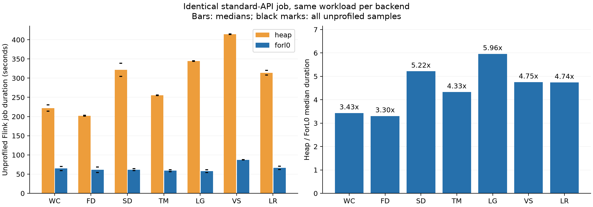
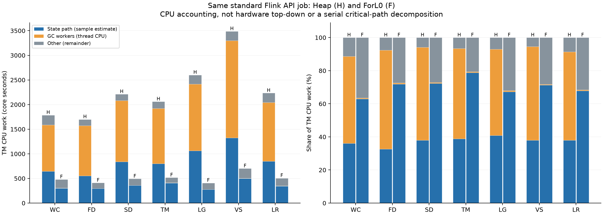

# 同一标准 API job 的公平对比与后端优化（2026-11-03）

Job 对 backend 无感知：同一 JAR、源数据、拓扑、状态描述符、访问语句和参数，只由 Flink 配置选择 Heap 或 ForL0。此前 job 分别调用扩展 API 和标准 API 的跨后端加速比已撤回；本报告只采用重新运行的标准 API 数据。

## 正式耗时

以下为不带 profiler 的 Flink REST duration，包含建表、JIT、网络和 GC。N 和全部样本范围随表给出；按用户要求提高输入量，使更快的 ForL0 也运行约一分钟或更长；两个后端的成对输入量始终相同。

| Workload | 输入记录 | Heap 中位数 s（范围；N） | ForL0 中位数 s（范围；N） | 比值 |
|---|---:|---:|---:|---:|
| WC | 48,000,000 | 221.965 (213.738–230.192; n=2) | 64.681 (59.239–70.123; n=2) | 3.43× |
| FD | 32,000,000 | 202.057 (200.898–203.216; n=2) | 61.164 (53.973–68.355; n=2) | 3.30× |
| SD | 24,000,000 | 321.525 (304.286–338.764; n=2) | 61.643 (59.367–63.919; n=2) | 5.22× |
| TM | 24,000,000 | 255.419 (254.510–256.329; n=2) | 59.022 (56.629–61.414; n=2) | 4.33× |
| LG | 12,000,000 | 344.697 (343.919–345.475; n=2) | 57.834 (54.063–61.605; n=2) | 5.96× |
| VS | 3,000,000 | 414.462 (413.824–415.099; n=2) | 87.245 (86.979–87.512; n=2) | 4.75× |
| LR | 3,000,000 | 314.188 (308.339–320.037; n=2) | 66.330 (62.013–70.647; n=2) | 4.74× |



样本数量有限，不能把这些比值外推为任意 Flink 作业的性能保证。完整运行顺序和每次命令保留在 raw 数据中。

## 共同 workload 与内部实现

保留 [ICDE17 原文 Figure 5](https://www.comp.nus.edu.sg/~hebs/pub/shuhaoICDE17a.pdf) 七个应用的任务与边。使用数值状态适配原任务框架，非原始生产算法或原始数据集的完整复现。每个普通有状态算子整体使用至多 524288 个实体 key，每个 key 有 64 个 Long feature，并分布到 8 个并行子任务；每次输入执行 128 对标准 MapState.get/put，并有该任务角色所需的标准 ValueState.value/update。Global ACD 保留单全局聚合，feature width=4、touches=1。没有新增压力算子。

feature 为连续小整数键，增量统一为 1,000,000,007，使值超出 boxed Long 缓存。这是两个后端共同执行的有利于 primitive 连续存储的访问设计。没有 ForL0 类型判断、反射、扩展 API 或分别选取状态表示。[Flink HeapMapState 标准路径](https://github.com/apache/flink/blob/release-1.20/flink-runtime/src/main/java/org/apache/flink/runtime/state/heap/HeapMapState.java) 也不逐值序列化，收益不能归为省去了 Heap 本来就没有的序列化。

实际共同循环见 [LongStateAccess.java](../benchmark/benchset/src/main/java/org/apache/flink/benchmark/benchset/LongStateAccess.java)：

```java
Long old = state.get(slot);
long next = (old == null ? 0 : old) + 1_000_000_007L;
state.put(slot, next);
```

ForL0 的优化全部位于后端：Long 读取减少 JNI 数组回写；小而密集的整数 Map 自动转为连续布局；完整连续行使用后端内部的直接内存访问，减少逐元素 JNI 往返。原生变更和 snapshot prepare 通过 epoch 使旧视图失效，snapshot 活跃时不提供直接写视图。checkpoint 本轮未启用，CP 性能留待单独测试。

复测正式计时可使用仓库脚本，`--fresh-jvm` 保持每次从新 JVM 开始：

```bash
python3 benchmark/scripts/run_benchset.py --backend all --touches 128 --rounds 2 --fresh-jvm
```

本次实际 JAR、版本库、源码、逐次命令与采集脚本一并保留，复核原始结果使用 reproduction/benchmark.jar 与 runs/*/command.json。

## 无 profiler 的 GC 核对

下表直接使用正式计时区间的进程/线程 CPU 计数，每项为两次测量的中位数；不依赖火焰图。GC 仅指 GC 工作线程，状态路径另由后面的 profile 估计。

| Workload | 总 CPU Heap / ForL0 s | GC CPU Heap / ForL0 s | GC 占减少 CPU 的比例 | 平均使用核数 Heap / ForL0 |
|---|---:|---:|---:|---:|
| WC | 1741.83 / 462.08 | 938.47 / 2.77 | 73.1% | 7.85 / 7.15 |
| FD | 1598.42 / 446.40 | 933.24 / 2.66 | 80.8% | 7.91 / 7.35 |
| SD | 2525.49 / 443.40 | 1347.92 / 2.75 | 64.6% | 7.85 / 7.20 |
| TM | 1979.97 / 439.87 | 1089.49 / 2.75 | 70.6% | 7.75 / 7.44 |
| LG | 2616.91 / 428.76 | 1371.88 / 3.10 | 62.6% | 7.59 / 7.42 |
| VS | 3125.64 / 660.06 | 1859.60 / 3.74 | 75.3% | 7.54 / 7.56 |
| LR | 2408.66 / 486.34 | 1281.82 / 3.54 | 66.5% | 7.67 / 7.34 |

两台 TM 的平均 CPU 使用合计均低于八核，ForL0 没有通过多用 CPU 获取这些收益。

## CPU 与 GC 归因

下表来自单独的 CPU profiler 作业，不与上面的正式计时样本混合。单位为两台 TM 合计的 CPU 秒；状态路径是基于每线程调用栈比例的采样估计，GC 工作线程 CPU 来自 /proc 计数，其他是剩余项。状态路径包括访问循环、更新算术、分配及 mutator 写屏障等开销。这三类是互斥的 CPU 记账项，不是相互独立的因果机制。

| Workload | Heap 状态 CPU | ForL0 状态 CPU | Heap GC CPU | ForL0 GC CPU | Heap 其他 CPU | ForL0 其他 CPU |
|---|---:|---:|---:|---:|---:|---:|
| WC | 644.08 | 301.52 | 940.09 | 2.84 | 202.62 | 174.46 |
| FD | 554.10 | 295.46 | 1017.17 | 2.66 | 128.89 | 112.60 |
| SD | 839.83 | 356.92 | 1242.28 | 2.90 | 129.20 | 133.31 |
| TM | 801.40 | 407.67 | 1121.57 | 2.82 | 137.37 | 106.63 |
| LG | 1063.51 | 275.34 | 1354.30 | 3.14 | 183.91 | 130.69 |
| VS | 1322.87 | 499.98 | 1974.09 | 3.74 | 191.45 | 197.91 |
| LR | 849.42 | 343.31 | 1191.45 | 3.55 | 193.46 | 159.61 |



这里的 CPU 占比不等于并行流水线中串行临界路径的墙钟占比。不能直接用“状态 CPU 节约秒数”减作业耗时。下式按 8 核归一化，作为 CPU 工作量与墙钟时间的记账关系，而非单因素因果干预：

`T = (state_CPU + GC_CPU + other_CPU) / 8 + unused_capacity_equivalent`。最后一项包含启动、等待、负载不均和其他未使用容量。CPU 边界按 REST 开始/结束时间对 0.5 秒线程计数插值。

| Workload | 减少总 CPU s | 其中 GC CPU s（占减少量） | 其中状态 CPU s（占减少量） | 减少 CPU / 8 s | profile 墙钟减少 s |
|---|---:|---:|---:|---:|---:|
| WC | 1307.96 | 937.25 (71.7%) | 342.55 (26.2%) | 163.50 | 164.22 |
| FD | 1289.44 | 1014.51 (78.7%) | 258.64 (20.1%) | 161.18 | 160.44 |
| SD | 1718.17 | 1239.39 (72.1%) | 482.91 (28.1%) | 214.77 | 221.14 |
| TM | 1543.23 | 1118.75 (72.5%) | 393.73 (25.5%) | 192.90 | 187.92 |
| LG | 2192.55 | 1351.15 (61.6%) | 788.17 (35.9%) | 274.07 | 288.32 |
| VS | 2786.78 | 1970.35 (70.7%) | 822.89 (29.5%) | 348.35 | 378.77 |
| LR | 1727.86 | 1187.90 (68.7%) | 506.12 (29.3%) | 215.98 | 218.79 |

以 VS 为例，Heap 的状态路径占总 CPU 37.9%，GC 工作线程占 56.6%。若只理想化消除状态工作、保持其他工作与并行效率不变，CPU 工作量模型的上限约 1.61×；同时理想化消除状态与 GC 的上限约 18.22×。这两个值不是对真实并行墙钟时间的保证。实际观测是两方面共同减少，不能解释为仅靠状态查询快了数倍。

VS 的 CPU 工作量比为 4.97×，平均使用核数从 7.44 到 7.80。墙钟比满足 `CPU 工作量比 × 平均使用核数比`，得到 5.21×。状态路径 CPU 减少 62.2%，GC 工作线程 CPU 减少 99.81%。这说明收益可以由相同八核上的实际工作减少解释。

若固定 GC 和其他 CPU 工作，仅代入已测得的状态路径减少量，CPU 工作量模型约为 1.31×；若固定状态和其他工作，仅代入 GC 工作线程减少量，则约为 2.30×。这是记账模型，不是两次独立因果实验，不能把两个加速比相加。

按 8 核折算，VS 的状态路径、GC、其他工作分别减少 102.86、246.29、-0.81 等效秒，未用容量项减少 30.42 秒，合计对应 profile 作业墙钟减少 378.77 秒。这是归一化的时间记账，不是四个独立实验测出的墙钟因果效应。

## GC 暂停

暂停单位为每个 JVM 的 STW 秒数。两个 TM 可以同时暂停，因此不能把它们直接相加作为作业总暂停。

| Workload | 后端 | TM1 暂停 s | TM2 暂停 s | 两 TM 暂停时间并集 s |
|---|---|---:|---:|---:|
| WC | heap | 54.490 | 54.753 | 80.337 |
| WC | forl0 | 0.425 | 0.462 | 0.887 |
| FD | heap | 51.214 | 58.217 | 81.572 |
| FD | forl0 | 0.388 | 0.388 | 0.776 |
| SD | heap | 86.718 | 87.309 | 157.788 |
| SD | forl0 | 0.411 | 0.415 | 0.826 |
| TM | heap | 74.357 | 76.554 | 148.729 |
| TM | forl0 | 0.393 | 0.417 | 0.751 |
| LG | heap | 89.909 | 86.762 | 153.734 |
| LG | forl0 | 0.499 | 0.500 | 0.974 |
| VS | heap | 143.053 | 159.190 | 256.758 |
| VS | forl0 | 0.486 | 0.475 | 0.961 |
| LR | heap | 93.373 | 92.038 | 155.009 |
| LR | forl0 | 0.521 | 0.555 | 1.076 |

## Java 分配 profile

独立 WC 分配 profile 使用相同的 WC 长作业输入、128 次访问。下面是 async-profiler 分配采样估计的字节权重，包含建表与作业启动；它不统计 C++ malloc。不能把这些数字理解成两后端的总内存用量。

| 后端 | Java 分配采样权重 GiB | 含 Long 栈的权重 GiB |
|---|---:|---:|
| heap | 195.803 | 169.391 |
| forl0 | 330.849 | 306.263 |

本次分配 profile 的 ForL0 Java 分配字节权重高于 Heap，不能据此声称分配更少。GC 改善应结合状态存储位置和引用更新分析：独立 WC CPU-profile 作业中，两台 TM 合并的各次 GC 后堆占用中位数为 Heap 5604 MiB、ForL0 36 MiB；G1 refinement 线程 CPU 为 493.32 / 0.00 秒，平行 GC worker CPU 为 434.58 / 2.71 秒。

GC 后堆占用包含尚未回收的老年代垃圾，不能当作精确存活集，也不包含 C++ 状态内存。结合后端代码，这支持“移除 Java 堆中的长期状态对象图和大量堆引用更新，减少扫描与 remembered-set 工作”的解释；不是把分配总量减少作为收益来源，也没有单独隔离各 GC 机制的因果贡献。[G1 refinement 源码](https://github.com/openjdk/jdk11u/blob/master/src/hotspot/share/gc/g1/g1ConcurrentRefineThread.cpp)。

分配火焰图也显示 Long 装箱仍是后续可优化点；当前实现没有做到零分配。

## 同一个 VS job 上的后端优化过程

这组诊断保持 2M 输入、524288 keys、width=64、touches=128 与同一 JAR 不变。Heap 是固定实现；R0–R4 均为 ForL0 内部变化。

| 实现 | profile 耗时 s | 状态 CPU s（估计） | GC CPU s |
|---|---:|---:|---:|
| Heap | 319.042 | 836.90 | 1393.86 |
| r0 | 200.571 | 1436.41 | 4.07 |
| r1 | 151.548 | 1038.48 | 3.91 |
| r2 | 126.535 | 813.90 | 3.75 |
| r3 | 67.564 | 395.45 | 3.46 |
| r4 | 66.553 | 362.55 | 3.44 |

R0：本轮公平基线；R1：缩短 Long Java 热路径并用原始 JNI 返回值；R2：标准 put 自动选择连续布局；R3：完整连续行直接内存访问；R4：在同一实体的连续访问期间重新尝试采用已形成的连续行。各版原生库和后端 JAR 的哈希保留在 measurement 中。

## 资源与可复核性

Flink 1.20.3、BiSheng Java 11.0.32、Kunpeng 920。JM 4 核/8 GiB；两台 TM 各 4 核/32 GiB、4 slots；两个后端采用相同的 21.875 GiB JVM heap 和 8 GiB task off-heap 配置，其余用于 Flink/JVM 开销。TM1 使用 CPU 4–7，TM2 使用 8–11，taskset 在启动 Java 前生效。[JNI](https://docs.oracle.com/en/java/javase/11/docs/specs/jni/design.html) 与 C++ 原生线程在相同 OS 线程/[继承 affinity](https://man7.org/linux/man-pages/man3/pthread_create.3.html) 范围内执行；本轮每 0.5 秒检查全部 JVM 线程，未发现越界 affinity。CPU 计数包括 Java、C++ 和 GC。

CPU affinity 不是独占 CPU，也不是不可修改的 cpuset；Flink 的 32 GiB process memory 是配置预算，不是每 TM 的硬 cgroup 限额。本轮没有通过后端代码扩大 affinity。

所有作业关闭 L0 和 checkpoint；拓扑、sink 记录数、source signature 与 feature projection 成对一致。汇总校验不声称逐 key 复现原始业务算法。编译和现有原生/真实 JNI 状态语义检查通过。

CPU 火焰图与 Java 分配火焰图分别位于 runs 与 allocation/runs；GC 原始日志位于 runtime-evidence；完整命令、图、sink、CPU/affinity 样本、JAR/原生库哈希均保留。所有更改在远端 briskstate_workspace，未提交、未推送。

PMU 仍被宿主机权限阻止，perf_event_paranoid=4，缺少 CAP_PERFMON，/proc/sys 只读；DevKit/kperf 不能绕过该限制。因此本报告没有 Retiring、Backend/Frontend Stall 或 DRAM Bound 的实测比例，CPU 图也不是微架构 top-down 图。
