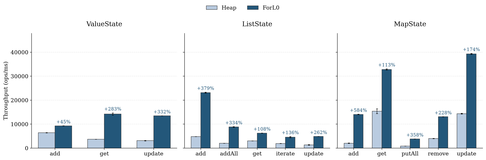
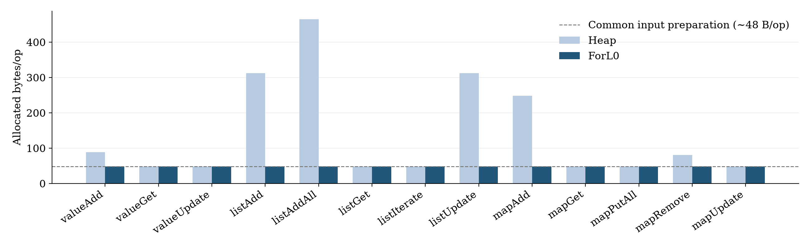
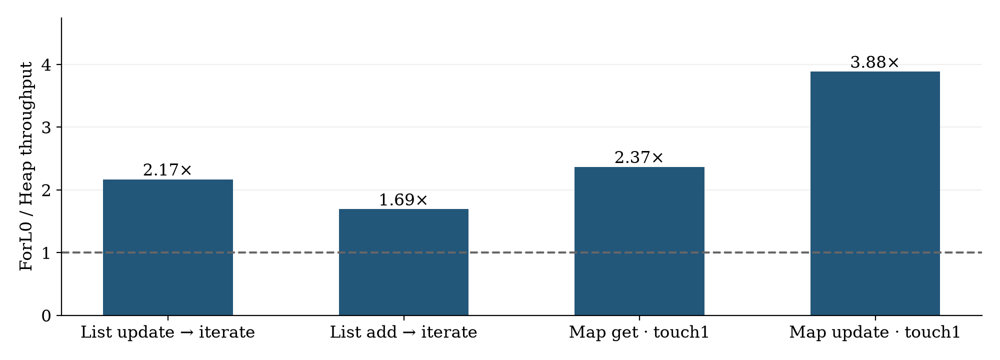

# ForL0 标准状态 API 微基准优化报告

最终实现：**R30**；Java 11、Flink 1.20.3、鲲鹏 920；L0 和 checkpoint 关闭。13 项原基准全部超过 Heap，吞吐比为 **1.45–6.84 倍**。原先负提升的 Value add、List add/get/iterate 均已转正。主图采用同一最终版本的正式数据。



图可导出：[SVG](BriskState_State_Access_Optimization_Assets/analysis/state-operations.svg) · [PDF](BriskState_State_Access_Optimization_Assets/analysis/state-operations.pdf)。

## 1. 结果与公平性

|标准操作|Heap ops/ms|ForL0 ops/ms|吞吐比|每次调用耗时 ns：Heap → ForL0|
|---|---:|---:|---:|---:|
|valueAdd|6,407|9,289|1.45×|156.1 → 107.7|
|valueGet|3,718|14,249|3.83×|269.0 → 70.2|
|valueUpdate|3,119|13,480|4.32×|320.6 → 74.2|
|listAdd|4,829|23,138|4.79×|207.1 → 43.2|
|listAddAll|2,036|8,833|4.34×|491.2 → 113.2|
|listGet|3,009|6,265|2.08×|332.3 → 159.6|
|listIterate|1,931|4,566|2.36×|517.9 → 219.0|
|listUpdate|1,350|4,892|3.62×|740.5 → 204.4|
|mapAdd|2,057|14,066|6.84×|486.0 → 71.1|
|mapGet|15,391|32,799|2.13×|65.0 → 30.5|
|mapPutAll|838|3,838|4.58×|1192.9 → 260.6|
|mapRemove|3,986|13,086|3.28×|250.9 → 76.4|
|mapUpdate|14,367|39,313|2.74×|69.6 → 25.4|

计时包含同样的 `setCurrentKey` 和标准 Flink 状态调用。Value add 是对不存在 key 的 `update`，Value update 是覆盖现有值；Map add 是已清空外层实体上的第一次 `put`。两项插入都通过相同的计时外清理保持有界，清理后首次 update/put 重新建立逻辑条目。

两后端使用同一个冻结 JMH 应用，SHA-256 `bc258cea2877431005b499210096217e0ca6adcd24ddcb142976c87c26ec6ad6`；区别仅为构建后端的参数。计时方法只调用公开的标准状态 API，后端选择局限于 setup factory。优化发生在后端的标准 API 实现内部，`putAll` 的内部批处理也仍由同一标准调用触发。

每项采用 Heap → ForL0 → ForL0 → Heap，两个独立 fork/后端，每 fork 3×3s 预热、5×3s 测量；Value add 延长到 10×5s 预热、5×5s 测量。图的误差线仅表示两个 fork 均值的最小/最大值。每个 fork 的全部迭代、命令和进程记录见 [正式原始目录](BriskState_State_Access_Optimization_Assets/formal-r30/metadata.json) 与 [CSV](BriskState_State_Access_Optimization_Assets/analysis/state-microbenchmarks.csv)。

每个 JVM 只有一个基准线程，整个进程绑 CPU 4–7，`ActiveProcessorCount=4`，Java 堆固定 8GiB。所有已采样 JVM 后代进程、GC/JIT/Cleaner/native 线程的允许 CPU 掩码均通过检查；ForL0 实际加载的原生库也与候选路径一致。C++ 在这些线程上执行，不存在额外使用其他 CPU 的情况。CPU 绑定不是独占物理核，宿主机仍有共享负载；8GiB 是 Java 堆限制，不是包含原生内存的进程总 RSS 限制。

状态规模为 1,048,576 个实体 key；List 每实体 16 个 Long，Map 每实体 64 对 Long/Long，读写 Map 的主测试每次切实体后连续访问 64 次。数值超过 Long 装箱缓存范围，内部 Map key 为共同的连续小整数。两个后端的数据、顺序和调用方法完全相同。这是有利于 primitive 连续布局的负载，不能据此声称任意类型或访问模式都获得相同倍数。

## 2. 保留了哪些有效优化

- **共享分页 key 索引**：小整数 key 直接索引原生页，页中的 key-group 标记保持组隔离。页在所有 key group 间共享，避免按组重复分配巨大数组。负数、大 key、稀疏域和组冲突回退 Swiss；分配仍进入原生计账，逻辑条目数、getKeys 与 COW 保持一致。
- **标准 Value/List 写入直接路径**：在已有页、已有容量、无活跃快照的条件下，直接读写 primitive 数据，消除逐次 JNI；首次分配、扩容和快照期间仍走原生受控路径。Value 清理保留带组标记的空槽，重插入维护相同的逻辑存在性与计数。
- **List 自适应读取与统一迭代器**：一次性读取直接复制到 primitive Java 数组；同版本读满 8 次后建立可复用的不可变原生快照。两个载体使用同一种迭代器，在 primitive 值合并后统一装箱，让 JIT 消除临时 Long。读取结果在更新、clear 和后端释放后仍有效；Cleaner 只负责独立快照缓冲的生命周期。
- **Small / dense Map 直接路径**：至多 4 对键值内联；增长后转 Hash，密集小整数转 dense。直接访问存在位、值和大小，覆盖 partial-dense 的 put/remove；最后一条删除回原生维护外层条目。结构变化更新 epoch，使旧完整行视图失效。
- **标准 putAll 内部复用**：完整 dense 行只解析一次；循环内保留 epoch 检查，遇到越界 key 引发 Hash 提升后不会继续写旧地址。ABBA pilot 从约 1,953 提至 3,916 ops/ms，约 2.01 倍，才保留该改动。
- **逐记录 release-store 热点**：快照期间已经禁用直接写，mailbox 上的既有页 tag 存储可使用普通对齐写；快照准备通过组 mutex 发布之前的写。保留必要的快照与 epoch 同步。独立 ABBA 的 Value add 为 8,201/8,162 → 9,098/9,175 ops/ms，约 +11.7%。

还有一项没有采用的布局试验：R31 将 scalar tag 与值交错存放，Value add 相对 R30 约 +77.5%，但 get/update 分别约 −13.6%/−17.1%，标量页从 12 增至 16B/key。因此保留分离布局，维持持续读取与覆盖写的表现。完整对照见 [选型记录](BriskState_State_Access_Optimization_Assets/FINAL_SELECTION.json)。

列表缓存还对照了删除 C++ shared_ptr/JNI 全局引用、页内缓存行对齐、扁平 Java 对象表三个候选。前两者的 get/iterate 均退化；扁平表 iterate 约 +8.1%，get 约 −1.9%，没有形成稳定的全面收益。因此本版保留 R30 的缓存组织，详细原始分数保存在选型记录和各 pilot 目录中。

源码差异见 [final-source.patch](BriskState_State_Access_Optimization_Assets/final-source.patch)。源代码见 [r30-source](../pom.xml)，主要入口是 [PrimitiveLongAccess](../src/main/java/org/apache/flink/state/forl0/PrimitiveLongAccess.java)、[ListState](../src/main/java/org/apache/flink/state/forl0/ForL0ListState.java)、[MapState](../src/main/java/org/apache/flink/state/forl0/ForL0MapState.java)、[LongKeyTable](../src/main/native/engine/long_key_table.h)。

## 3. 状态访问和 GC 各解释什么



|操作|B/op：Heap / ForL0|每 fork GC MXBean ms：Heap / ForL0|采样进程峰值 RSS GiB：Heap / ForL0|
|---|---:|---:|---:|
|valueAdd|88.0 / 48.0|708 / 4|2.43 / 4.94|
|valueGet|48.1 / 48.0|6 / 36|0.64 / 1.47|
|valueUpdate|48.1 / 48.0|440 / 26|0.63 / 1.64|
|listAdd|312.2 / 48.1|4168 / 28|2.91 / 1.11|
|listAddAll|464.3 / 48.1|4513 / 24|3.46 / 1.02|
|listGet|48.1 / 48.0|4 / 102|1.13 / 1.25|
|listIterate|48.1 / 48.0|3 / 300|1.13 / 1.14|
|listUpdate|312.2 / 48.0|5152 / 28|2.84 / 0.93|
|mapAdd|248.2 / 48.1|2466 / 23|8.14 / 1.58|
|mapGet|48.0 / 48.0|4 / 9|7.27 / 5.54|
|mapPutAll|48.2 / 48.1|80 / 21|4.90 / 1.39|
|mapRemove|80.2 / 48.1|488 / 18|4.95 / 1.28|
|mapUpdate|48.0 / 48.0|11052 / 3|7.53 / 5.54|

GC 数字是整个测量区间的 MXBean collection time，普通项每 fork 共 15s，Value add 共 25s；它应与 GC 工作线程 CPU 和状态调用耗时分别解读，避免把重叠因素相加。RSS 包含原生内存，表中为每秒采样得到的峰值。

每次输入准备约分配 48B（两个 Long），在计时外执行；GC profiler 会计入这些分配。Value get/update、Map get/update 和热 List get/iterate 的双方常态分配均约 48B/op，而计时耗时仍明显不同。读取路径的收益因此有实质的查找、JNI、布局和 JIT 依据，不能全部解释成省 GC。GC 活跃度与 live set 也有关系，相同分配下的 GC 贡献仍需结合 live set 与 CPU 栈判断。

分配归因还必须区分准备代码和计时操作。实际 Flink 1.20.3 `HeapListState.update` 的字节码确认，它先建默认 ArrayList 再逐项 add。16 元素会产生 24B 列表对象，以及容量 10/15/22 的 56/80/104B 数组，共 **264B**，与实测吻合：

|Heap 项|约 B/op 的来源|
|---|---|
|List add：312|输入 48 + 计时外复位 update 264；计时 add 16→17 尚在容量22内，不额外扩容|
|List addAll：464|输入48 + 计时外复位264 + 计时扩容至33的数组152|
|List update：312|输入48 + 计时 update 264|
|Value add：88|输入48 + 新 StateMapEntry 40|
|Map add：248|输入48 + 外层 entry40、HashMap48、bucket数组80、node32|
|Map remove：80|输入48 + 计时外恢复被删 node32；计时 remove 自身不分配|

因此不能把 List add 的全部 264B 差异归给计时 add 自身。准备阶段产生的 GC 和缓存效应仍会进入后续执行，这是该固定基准的适用边界，而不是两个后端运行了不同 job。原始字节码证据见 [heap-list-bytecode.txt](BriskState_State_Access_Optimization_Assets/heap-list-bytecode.txt)。

一个直接的归因例子是 List iterate：自适应缓存早期实现引入两种迭代器，造成 **456B/op**；统一类型后回到 **48B/op**，ABBA 吞吐约 2,713 → 4,222 ops/ms。另一个例子是一次性写读：直接复制去掉 JNI 后，虽然不可变快照对象使分配从 192 增到约 240B/事务，吞吐仍显著上升。这说明只看分配量无法解释访问效率。

## 4. 避免只优化热读取：边界实验



|访问模式|Heap|ForL0|吞吐比|
|---|---:|---:|---:|
|listUpdateThenIterate|1,265|2,743|2.17×|
|listAddThenIterate|3,497|5,913|1.69×|
|mapGet（touches=1）|1,513|3,583|2.37×|
|mapUpdate（touches=1）|1,343|5,217|3.88×|

前两项单位为事务/ms，每事务同样执行一个标准写 API、一个 get API，并遍历 16/17 个元素；后两项单位为 API ops/ms，每次调用都切换实体。两个分组分别按事务/ms和API ops/ms呈现，倍数用于各自负载内对照。边界 fork 运行在 CPU 96–99，两个后端相同；主图仍只使用 CPU 4–7 的正式数据。

无条件为每次新列表版本建立 Cleaner/native snapshot 曾使写读混合明显落后于 Heap：约 388/478 事务/ms。该策略没有保留。最终采用自适应缓存、一次性直接复制、统一迭代器，上表给出了最终版本的实际结果。频繁切 key 的 Map 对照也说明，优势不完全依赖 64 次访问摊薄一次 JNI。

## 5. 火焰图与验证

下表是可识别计时调用栈中的 JNI 样本占比；准备与 GC 样本另列。采样不是串行关键路径分解，不能把这些比例乘以应用墙钟时间。完整分类与叶子栈见 [cpu-samples.json](BriskState_State_Access_Optimization_Assets/analysis/cpu-samples.json)。

|采样案例|JNI / 计时栈样本|准备栈样本|GC线程样本|
|---|---:|---:|---:|
|listIterate-r18-FORL0|92.0%|121|21|
|listIterate-r30-FORL0|0.0%|348|206|
|listIterate-r30-HEAP|0.0%|181|0|
|mapAdd-r18-FORL0|90.2%|1636|6|
|mapAdd-r30-FORL0|0.0%|2427|9|
|mapAdd-r30-HEAP|0.0%|1196|9934|
|valueAdd-r18-FORL0|86.0%|1894|7|
|valueAdd-r30-FORL0|0.0%|2494|2|
|valueAdd-r30-HEAP|0.0%|1908|6273|

火焰图（点击可交互放大）：

- [listIterate-r18-FORL0](BriskState_State_Access_Optimization_Assets/profile-r30/listIterate-r18-FORL0/org.apache.flink.state.benchmark.LongStateMicrobenchmarks.listIterate-Throughput-backendType-FORL0-keyCount-1048576/flame-cpu-forward.html)
- [listIterate-r30-FORL0](BriskState_State_Access_Optimization_Assets/profile-r30/listIterate-r30-FORL0/org.apache.flink.state.benchmark.LongStateMicrobenchmarks.listIterate-Throughput-backendType-FORL0-keyCount-1048576/flame-cpu-forward.html)
- [listIterate-r30-HEAP](BriskState_State_Access_Optimization_Assets/profile-r30/listIterate-r30-HEAP/org.apache.flink.state.benchmark.LongStateMicrobenchmarks.listIterate-Throughput-backendType-HEAP-keyCount-1048576/flame-cpu-forward.html)
- [mapAdd-r18-FORL0](BriskState_State_Access_Optimization_Assets/profile-r30/mapAdd-r18-FORL0/org.apache.flink.state.benchmark.LongStateMicrobenchmarks.mapAdd-Throughput-backendType-FORL0-keyCount-1048576-touchesPerKey-64/flame-cpu-forward.html)
- [mapAdd-r30-FORL0](BriskState_State_Access_Optimization_Assets/profile-r30/mapAdd-r30-FORL0/org.apache.flink.state.benchmark.LongStateMicrobenchmarks.mapAdd-Throughput-backendType-FORL0-keyCount-1048576-touchesPerKey-64/flame-cpu-forward.html)
- [mapAdd-r30-HEAP](BriskState_State_Access_Optimization_Assets/profile-r30/mapAdd-r30-HEAP/org.apache.flink.state.benchmark.LongStateMicrobenchmarks.mapAdd-Throughput-backendType-HEAP-keyCount-1048576-touchesPerKey-64/flame-cpu-forward.html)
- [valueAdd-r18-FORL0](BriskState_State_Access_Optimization_Assets/profile-r30/valueAdd-r18-FORL0/org.apache.flink.state.benchmark.LongStateMicrobenchmarks.valueAdd-Throughput-backendType-FORL0-keyCount-1048576/flame-cpu-forward.html)
- [valueAdd-r30-FORL0](BriskState_State_Access_Optimization_Assets/profile-r30/valueAdd-r30-FORL0/org.apache.flink.state.benchmark.LongStateMicrobenchmarks.valueAdd-Throughput-backendType-FORL0-keyCount-1048576/flame-cpu-forward.html)
- [valueAdd-r30-HEAP](BriskState_State_Access_Optimization_Assets/profile-r30/valueAdd-r30-HEAP/org.apache.flink.state.benchmark.LongStateMicrobenchmarks.valueAdd-Throughput-backendType-HEAP-keyCount-1048576/flame-cpu-forward.html)

实际状态检查通过：143 个原生测试、27 个 Java 测试，覆盖页索引的组冲突/稀疏回退、条目数和 getKeys、在途 checkpoint 的覆盖后恢复、bulk 中途转换存储，以及原生读取结果跨更新和 dispose 的生命周期。benchmark 本身始终不开 checkpoint。这些检查直接使用真实后端和标准状态接口。

## 6. 容器落地与端到端回归

已在远程分支 `briskstate_workspace` 更新源码、选定 JAR/native、Maven 本地依赖和后续微基准构建。未提交或 push。默认集群恢复为 1 JM（4 CPU/8GiB）、2 TM（各4 CPU/32GiB，task offheap 8GiB），L0/CP 关闭。

冻结的 Long benchmark job 仍是原来的 JAR；WC 48M、VS 3M records、touches128。以下是最终版本的长作业 smoke，拓扑、sink record count、feature projection 和 source signature 都与已有基线一致，且 checkpoint 数为0。

|作业|输入records|本次ForL0墙钟|2TM总CPU|其中GC线程CPU|
|---|---:|---:|---:|---:|
|wc|48,000,000|66.828s|485.86s|2.73s|
|vs|3,000,000|82.373s|634.68s|1.54s|

这里的长作业次数用于检查落地和回归，不能与数小时前的 Heap 时间拼成新的高置信度提速比。此前完整内存矩阵与端到端 GC/状态 CPU 归因属于 **R18**，仍见 [冻结完整报告](BriskState_Deep_Optimization_Report.html)。其约70.6% GC、29.2%状态 CPU节省的分解不能冒充本版新测量；微基准倍数也不能直接替代端到端倍数。

对于任意应用，若状态阶段占串行关键路径比例为 f，阶段加速 r 的理论上限为 `1 / ((1-f) + f/r)`；实际 Flink 还有并行、背压、GC与调度。这里分别给出计时、分配、GC、CPU栈和边界控制，不将互相重叠的因素强行相加。

## 7. 复现与工件

- [正式命令](BriskState_State_Access_Optimization_Assets/formal-r30/commands.json)、[正式元数据](BriskState_State_Access_Optimization_Assets/formal-r30/metadata.json)、[逐项CSV](BriskState_State_Access_Optimization_Assets/analysis/state-microbenchmarks.csv)、[原始汇总JSON](BriskState_State_Access_Optimization_Assets/analysis/results.json)。
- [部署记录](BriskState_State_Access_Optimization_Assets/deployment.json)、[长作业回归记录](BriskState_State_Access_Optimization_Assets/macro-smoke/summary.json)、[选定版本](BriskState_State_Access_Optimization_Assets/FINAL_SELECTION.json)。
- 选定后端 SHA-256：`81d12bb9dc9366053b15159fb6a8b90ed1dfaf28cffdb4b4ba5104af9627f37b`。
- 原生库 SHA-256：`8ffa4d449766e03f9fe06efea91b59337c814fa34a71314ecfe1f34fd833ba03`。
- 冻结 JMH 应用 SHA-256：`bc258cea2877431005b499210096217e0ca6adcd24ddcb142976c87c26ec6ad6`。
- [完整校验清单](BriskState_State_Access_Optimization_Assets/MANIFEST.sha256)。源码和原始记录保留候选版本；复现主结果时使用最终选定版本，不能混用候选 binary。

普通项复现示例（改变 backendType 即运行另一后端，应用方法完全相同；正式 ABBA 完整命令在上面的 JSON 中）：

```sh
 taskset -c 4-7 java -Xms8g -Xmx8g -XX:ActiveProcessorCount=4 \
  -Djava.library.path=/root/briskstate-runtime/native \
  -cp /root/forL0-state-backend/target/flink-statebackend-forL0-1.0-SNAPSHOT.jar:/root/briskstate-setup/deep-opt-20261103/reproduction/micro-measured.jar \
  org.openjdk.jmh.Main 'LongStateMicrobenchmarks.listIterate$' \
  -p backendType=FORL0 -p keyCount=1048576 \
  -f 2 -wi 3 -w 3s -i 5 -r 3s -t 1 -prof gc
```

原生页保留到后端关闭，读缓存增加了 Java 元数据与独立原生快照；这是实际的空间/访问效率取舍，RSS 已一并给出。稀疏/大key、通用序列化状态和 checkpoint 性能没有用本图作推断。
