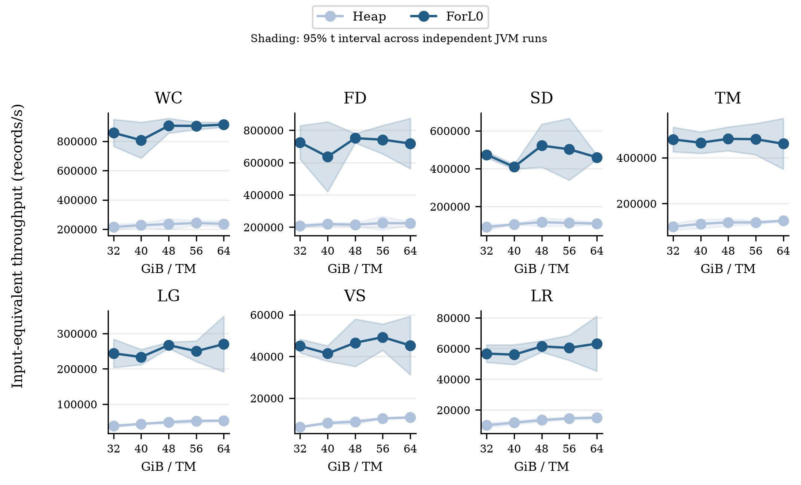
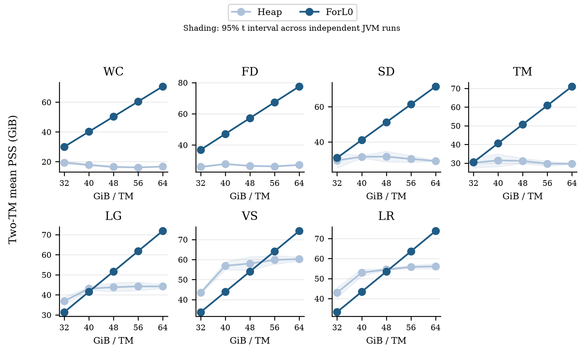

# 主实验结果说明（完整210次；完整归因见最终报告）

本说明基于2026-11-04至11-05完成的210次主测量：7 workload × 每TM32/40/48/56/64GiB × Heap/ForL0 × 3个独立JVM。两TM各4核，合计8核；同一后端无感知作业、相同状态域524,288实体、64个feature、每普通角色每输入128对标准MapState.get/put；checkpoint与ForL0 L0关闭。每次先完成key覆盖，再预热60s、测量120s。

性能量为按终端输出倍数归一化的input-equivalent records/s；LG/VS/LR分别除以3/8/12。以下比值为同轮配对F/H吞吐比的几何均值，绝对吞吐为3次运行的算术均值。

完整环境、归因与三后端微基准见[最终报告](REPORT.md)。

## 吞吐

35个条件全部有3次成对重复。总集合等权描述性几何均值4.345×，逐条件范围2.892–7.256×；35个条件的配对95% t区间下界均高于1（每条件n=3）。

| workload | 32GiB/TM | 40GiB/TM | 48GiB/TM | 56GiB/TM | 64GiB/TM |
|---|---|---|---|---|---|
| WC | 3.98× | 3.54× | 3.86× | 3.73× | 3.87× |
| FD | 3.48× | 2.89× | 3.49× | 3.29× | 3.20× |
| SD | 5.18× | 3.86× | 4.44× | 4.42× | 4.18× |
| TM | 4.82× | 4.18× | 4.09× | 4.09× | 3.66× |
| LG | 6.36× | 5.27× | 5.45× | 4.75× | 5.04× |
| VS | 7.26× | 5.09× | 5.33× | 4.76× | 4.17× |
| LR | 5.63× | 4.76× | 4.58× | 4.15× | 4.19× |

| workload | 32GiB Heap k/s | 32GiB ForL0 k/s | 64GiB Heap k/s | 64GiB ForL0 k/s | Heap32→64变化 |
|---|---|---|---|---|---|
| WC | 215.18 | 856.95 | 236.24 | 912.74 | +9.8% |
| FD | 208.07 | 724.71 | 223.60 | 718.13 | +7.5% |
| SD | 91.63 | 474.18 | 110.07 | 460.13 | +20.1% |
| TM | 99.56 | 479.62 | 125.45 | 460.75 | +26.0% |
| LG | 38.36 | 244.00 | 53.41 | 270.25 | +39.3% |
| VS | 6.20 | 45.02 | 10.81 | 45.27 | +74.2% |
| LR | 10.09 | 56.76 | 15.03 | 63.21 | +49.0% |

内存从32增至64GiB/TM，Heap在VS/LR/LG的吞吐分别增加74.2%/49.0%/39.3%，说明额外内存缓解了其部分开销。但集合加速比仍从32GiB的5.10×变为64GiB的4.01×。ForL0的端点吞吐变化约−3.9%至+11.4%，不是随预算翻倍而同比增加；中间点存在非单调和跨重复波动。

## 从无profiler主运行已经能量化的GC账目

35个条件中，按每百万输入的CPU工作量差值记账，专用GC worker解释了总CPU节省的57.4%–71.8%，中位数64.9%。这是CPU工作量差值分解，不是墙钟加速的独立因果占比。

| WC32GiB/TM：CPU秒/百万输入 | Heap | ForL0 |
|---|---|---|
| 总CPU | 35.925 | 8.615 |
| GC worker CPU | 18.159 | 0.010 |
| 非GC CPU | 17.766 | 8.605 |

该例的CPU节省中，GC worker占66.5%，非GC占33.5%。非GC包括状态、循环/装箱、框架、网络/JIT等，不能提前全部称为状态访问收益；状态/其他拆分等待独立火焰图矩阵。GC worker也不包括所有mutator屏障及VM Thread工作。

CPU实际使用核数按全主矩阵平均为Heap7.791、ForL0 7.548；所有捕获的线程亲和性均未发现超出角色允许掩码。因此这些结果没有显示ForL0通过额外CPU核取得收益。

## 进程驻留内存

以下是同一采样时刻两TM之和的平均PSS，单位GiB，不是单TM，也不是Java活对象大小。

| workload | 32GiB Heap/ForL0 PSS | 64GiB Heap/ForL0 PSS |
|---|---|---|
| WC | 19.42 / 30.03 | 16.72 / 70.56 |
| FD | 25.98 / 36.97 | 27.24 / 77.52 |
| SD | 29.51 / 30.97 | 29.19 / 71.50 |
| TM | 30.16 / 30.47 | 29.63 / 71.01 |
| LG | 36.92 / 31.40 | 44.20 / 71.92 |
| VS | 43.43 / 33.72 | 60.27 / 74.27 |
| LR | 42.96 / 33.26 | 56.07 / 73.78 |

32GiB时ForL0在LG/VS/LR的PSS较低，WC/FD较高；64GiB时七项均高于Heap。现有默认G1/Xms=Xmx设置下，不能声称ForL0整体更省驻留内存。Java GC后heap-used很低不等于总PSS低：其原生状态和空闲但仍驻留的Java堆页均计入PSS。代表性WC GC日志显示ForL0的Eden目标明显大于Heap，支持大年轻代/已触碰堆页是重要因素；这还不是完整原生/Java RSS所有权分解。

该主比较对齐的是每TM可配置process预算，而不是同一实测PSS。实际Xmx：32GiB时Heap30.125、ForL0 22.125GiB；64GiB时Heap62.125、ForL0 54.125GiB。ForL0另预留8GiB task off-heap；Flink预算不是OS硬RSS限制。40GiB时两后端压缩引用状态也不同，内存敏感性包含JVM自动策略变化。

## 稳定性与当前边界

Heap/ForL0各条件三次重复CV中位数分别3.16%/4.63%，最大7.77%/13.69%。但窗口内部另有问题：22/105次Heap的末30s吞吐比首30s低超过15%，ForL0为0/105。所有数据保留，不能把这些条件均视作已证明严格平稳；最终论文前需要结合GC周期检查并进行延长预热/窗口的验证。当前结果首先解释为该明确计时协议下的吞吐。

结果针对当前合成Long状态压力适配、相同标准API作业；不是原论文生产数据集的复现，也不涉及checkpoint、L0、稀疏通用序列化或RocksDB端到端比较。

## 可复核数据

- [35条件汇总CSV](analysis/main-results.csv)
- [210次运行CSV](analysis/main-runs.csv)
- [完整统计与置信区间JSON](analysis/conditions.json)
- [完整主运行分析JSON](analysis/formal-runs.json)

