# ForL0 R30 实验报告：七项 benchmark set 吞吐、内存梯度与三后端状态微基准

**状态：全部正式实验完成。**

后端范围按最终要求执行：benchmark set 比较 Heap 与 ForL0；RocksDB 仅出现在状态微基准。时间单位秒；内存采用二进制 GiB。本文区分原始实测、采样估计、统计推断及适用范围。

正式宏实验采集区间：2026-11-04 17:51:10 至 2026-11-05 12:45:18（Asia/Shanghai）；初始化和准备早于该首个计时窗口，RocksDB微基准采集时间另见原始文件。

在当前有成对数据的35个条件中，ForL0/Heap吞吐比点估计范围为2.89–7.26×；其中35个条件的配对95%区间下界超过1。逐条件结果、区间和未确定差异完整列出，不用单个最好结果代表全部负载。

35个workload/内存条件等权的描述性几何均值为4.35×。该数值概括本数值状态压力适配集合，不代表所有Flink作业；逐条件区间未作多重比较校正。

**解释范围：本轮是60s预热后的120s固定窗口吞吐；22次主运行存在首尾30s显著趋势，不能将全部条件称为已经证明严格平稳。所有原数据保留，具体诊断列于第4节。**

## 1. 研究问题与实验协议

RQ1：固定 CPU 和每 TM 总内存预算下，ForL0 对七项状态密集数值化 workload 的稳态吞吐有何影响？RQ2：内存预算从32到64GiB变化时，吞吐、GC和运行时/保留内存如何变化？RQ3：同一标准 Flink API 的操作级代价及其与端到端收益的关系是什么？

主实验以预热后固定窗口吞吐衡量持续运行性能，目标是稳态比较；实际是否平稳另行检查。它不是固定输入完成时间，也不与先前 R4/R18 的短作业或有限输入耗时拼接。完整协议及执行顺序分别见 [PROTOCOL.md](PROTOCOL.md)、[plan.json](plan.json)。

| 项目 | 设计 |
|---|---|
| 主矩阵 | 7 workloads × 5内存点 × 2后端 × 3独立JVM = 210次 |
| 内存点 | 每TM 32/40/48/56/64 GiB |
| 每次流程 | 全key覆盖并排空 → 至少60s预热 → 120s固定计数窗口 → 排空/保留内存诊断 → 正常完成 |
| 归因矩阵 | 7 workloads × 32/64GiB × 2后端 × 2独立JVM = 56次；独立于主计时 |
| 执行顺序 | seed20261104；每轮打乱35个workload/内存条件，同条件两后端相邻，交替先后顺序 |
| 统计单位 | 独立JVM；每秒计数和30s子窗口只用于平稳性诊断，不充当额外重复 |
| 数据筛选 | 所有成功完成的正式运行均保留；基础设施或正确性失败保留原始记录并注明原因，不按性能删慢样本 |

吞吐定义为 `sum(终端sink在窗口内完成的记录数) / sink输出倍数 / 120s`，单位 input-equivalent records/s。LG/VS/LR 的倍数分别为3/8/12；它消除拓扑输出数量不同造成的计数混淆。它仍然是本数值适配作业的吞吐，不是原始生产数据集吞吐或端到端延迟。

## 2. 完整实验环境与资源配置

| 层次 | 环境 |
|---|---|
| 处理器 | HiSilicon Kunpeng-920，aarch64，小端；192个在线逻辑CPU，每核1线程；lscpu报告4个48核cluster、8个NUMA节点，socket字段不可用，不据此猜测物理插槽数 |
| 缓存 | 每核L1d/L1i各64KiB、L2 512KiB；每个L3实例24MiB，8实例。原始lscpu与sysfs输出随附 |
| 宿主机与容器 | 宿主机/proc/meminfo显示约2TiB；容器memory.max=192GiB，cpu.max=32 CPU配额。宿主机共享，核心未独占 |
| OS | 容器openEuler24.03 LTS-SP3；宿主机kernel 5.15.0-25-generic；完整版本见environment目录 |
| Java | BiSheng OpenJDK11.0.32+9，64-bit Server VM，G1；每角色ActiveProcessorCount=4 |
| Flink | 1.20.3，发行版commit01e3a6d，Scala2.12发行包 |
| JM | 1个，CPU0–3，8GiB process memory |
| TM | 2个，分别CPU4–7/8–11，各4slot，默认并行度8；所有这些CPU位于NUMA node0。未设置内存页NUMA硬绑定 |
| 编译与实现 | ForL0 Java11 / 原生Release构建；R30源码、JAR、native二进制与精确SHA-256随附；无测量中代码调优 |
| 存储 | /root位于40GiB ext4 Longhorn PVC；/tmp位于容器overlay。不是已验证的独占本地NVMe；仅RocksDB微基准使用其本地DB文件 |
| 采集 | /proc进程/线程CPU和RSS约0.5s；smaps_rollup/PSS约2s；Flink REST指标请求约5s（本轮返回空列表，未作为JVM指标结果）；async-profiler4.4 ARM64 CPU采样5ms，精确裁剪JFR窗口 |

原始硬件、软件、cgroup、挂载、NUMA、编译器、git差异及二进制哈希见 [environment](environment/artifacts.json)。每次运行另保存最终config.yaml、JVM命令和VM.flags，实际Xmx与压缩引用变化以这些记录为准。

| GiB/TM | 后端 | 实际Xmx GiB | CompressedOops | CompressedClassPointers | G1 region MiB |
|---|---|---|---|---|---|
| 32 | heap | 30.125 | true | true | 8 |
| 32 | forl0 | 22.125 | true | true | 8 |
| 40 | heap | 38.125 | false | false | 16 |
| 40 | forl0 | 30.125 | true | true | 8 |
| 48 | heap | 46.125 | false | false | 16 |
| 48 | forl0 | 38.125 | false | false | 16 |
| 56 | heap | 54.125 | false | false | 16 |
| 56 | forl0 | 46.125 | false | false | 16 |
| 64 | heap | 62.125 | false | false | 16 |
| 64 | forl0 | 54.125 | false | false | 16 |

| 配置 | Heap | ForL0 |
|---|---|---|
| taskmanager.memory.process.size | 32–64GiB | 相同 |
| taskmanager.memory.task.off-heap.size | 0GiB | 8GiB |
| taskmanager.memory.managed.size | 0 | 0 |
| network min/max | 512MiB / 512MiB | 相同 |
| checkpoint / restart | 关闭 / none | 相同 |
| ForL0 L0 | 不适用 | 关闭 |
| operator chaining | 关闭 | 相同 |
| 任务并行度 | 8；Global ACD为1 | 相同 |

采用相同总process预算、按后端用途分配：Heap可将状态放入Java堆；ForL0预留8GiB task off-heap。Flink预算不是OS硬RSS限额，父容器192GiB是实际硬限制。本文提供真实PSS/RSS，不声称Java/C++总RSS都被分别限制为配置预算。CPU affinity约束整个TM及其Java、GC、JIT、Cleaner和原生线程，C++不获得额外核；逐线程允许掩码随原始数据保存。

ForL0还保留`native-memory.max-size=1GiB`的每StateEngine表分配器配置；它不是完整原生RSS上限，嵌套标准库容器等分配不能据此全部计账。原生C++17构建为Release、`-O3 -DNDEBUG -march=native`；R30后端Java release11，共同benchmark类target8，均运行于上述Java11。RocksDB使用发行版预编译JNI，不假定其编译目标与ForL0一致。[Flink官方内存说明](https://nightlies.apache.org/flink/flink-docs-release-1.20/docs/deployment/memory/mem_setup_tm/)与完整配置文件一并提供。

## 3. Workload、状态与初始化

| workload | 角色框架 | 每源记录终端输出 |
|---|---|---|
| WC | Split → Count | 1 |
| FD | Predict：二事件转移计数/异常分数 | 1 |
| SD | Moving Average → Spike Detection | 1 |
| TM | Map Match → Speed Calculate | 1 |
| LG | Geo Finder→Geo Status、Status Counter、Volume Counter三分支 | 3 |
| VS | Voice Dispatcher；RCRF/ECRF/ENCR/CT24/ECR24/Global ACD；FoFIR/URL/ACD；Score | 8 |
| LR | 速度、事故、车辆计数、事故通知、每日费用、收费通知、账户余额及原汇聚边 | 12 |

源首先覆盖524,288个Long实体key，此后使用每个源子任务固定seed `20261102+subtask` 的均匀随机流。普通有状态任务使用64个连续Long feature，每输入执行128对标准 `MapState.get/put`，增量1,000,000,007；另执行角色所需的标准ValueState和历史MapState访问。Global ACD保持单全局任务、width4/touches1，移动窗口长度16。实体域由8个并行子任务分担，不是每子任务各524,288实体。

共同初始化阶段将Predict的272个历史槽和Moving Average的16个环形槽通过标准API置零；之前缺失值在对应计算中同样解释为零。这样把有界字典先材料化，避免较快后端因预热处理更多记录而拥有更多逻辑条目。feature在首次覆盖中填齐。所有源到达屏障且终端计数达到期望倍数后，才释放稳态输入。初始化单独计时。

| workload | 普通有状态角色数 | 每源记录的普通角色处理次数 | 每源记录feature get/put对数 | feature value理论有效载荷 |
|---|---|---|---|---|
| WC | 1 | 1 | 128 | 256MiB |
| FD | 1 | 1 | 128 | 256MiB；另有272槽历史字典 |
| SD | 2 | 2 | 256 | 512MiB；另有16槽环形历史 |
| TM | 2 | 2 | 256 | 512MiB |
| LG | 4 | 4 | 512 | 1GiB |
| VS | 9+单全局角色 | 22+全局1 | 2816+全局1 | 2.25GiB+全局32B |
| LR | 8 | 16 | 2048 | 2GiB |

理论载荷只计算`实体数×feature数×8B`，不是实测footprint：没有计入Map键、哈希桶、节点、存在位、外层索引、对象头、容量余量和JVM。相同角色收到更多分支记录会提高访问量，但不会重复增加同一实体的64个feature槽。

Job没有后端类型判断或扩展API。相同源码/JAR只通过Flink配置选择后端；共同访问循环和事件表示与原冻结JAR字节码一致，见 [provenance.json](steady-job/provenance.json)。拓扑与真实有限输入结果的核验见 [oracle/summary.json](oracle/summary.json)；短验证运行不纳入性能统计。

稳态模式的命令中`numRecords=524288`用于覆盖阶段及参数有效性检查；连续输入由控制文件终止，实际总量保存在每次运行的source统计。不同后端在固定时间内完成不同长度的确定性输入前缀；比较的是相同生成规则、分布、状态规模和访问算法下的吞吐，不能要求不同长度流的原始checksum相等。

每次正常完成后，在控制器CPU上独立重放各source实际前缀，重建全key计数直方图，核对终端feature投影的闭式期望、记录倍数和源签名；[历史七项长作业验证](oracle-replay-prior/summary.json)也已验证该公式。该校验覆盖终端状态增量投影，并非所有中间状态或业务字段的逐条等价证明。

这是保留Zhang等ICDE2017 Figure5任务/边的**合成数值状态压力适配**，没有原始文本解析、真实地图匹配、生产电话数据或完整Linear Road语义。连续小整数和Long表示有意选择了ForL0擅长的访问模式；比较公平性来自两个后端执行相同作业，不代表通用类型和稀疏访问也有相同收益。

任务图来源为[Zhang等原文Figure5](https://www.comp.nus.edu.sg/~hebs/pub/shuhaoICDE17a.pdf)；实际节点、边（含重复边）、并行度及完整状态循环以随附源码/拓扑契约为准。

## 4. 完整 benchmark set：吞吐与内存敏感性

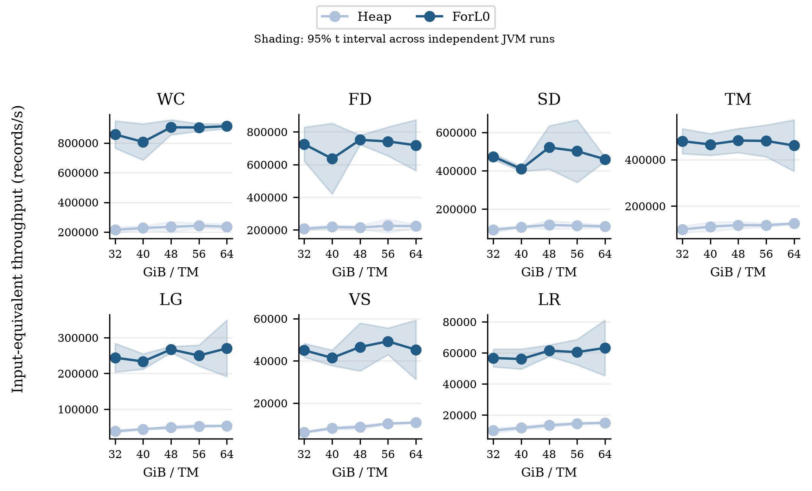

每个后端报告独立JVM均值和95% Student-t区间（n=3，df=2）；加速比采用同轮配对吞吐比的几何均值及log空间t区间。n较小，区间可能很宽；阴影不是每秒采样产生的伪重复置信区间。

| workload | GiB/TM | Heap records/s [95%CI] | ForL0 records/s [95%CI] | 配对F/H [95%CI] |
|---|---|---|---|---|
| WC | 32 | 215,179.9 [195,612.2, 234,747.6] | 856,950.5 [765,105.0, 948,796.0] | 3.98× [3.52, 4.51] |
| WC | 40 | 227,463.2 [213,905.6, 241,020.8] | 806,726.3 [684,815.5, 928,637.1] | 3.54× [3.14, 4.00] |
| WC | 48 | 234,923.9 [198,554.3, 271,293.4] | 905,167.9 [855,042.5, 955,293.3] | 3.86× [3.19, 4.66] |
| WC | 56 | 242,520.8 [226,223.3, 258,818.3] | 904,054.6 [878,745.4, 929,363.9] | 3.73× [3.45, 4.03] |
| WC | 64 | 236,238.7 [216,046.2, 256,431.2] | 912,737.6 [895,748.2, 929,727.0] | 3.87× [3.61, 4.14] |
| FD | 32 | 208,068.4 [197,564.8, 218,571.9] | 724,706.7 [621,065.0, 828,348.5] | 3.48× [3.01, 4.02] |
| FD | 40 | 218,602.3 [207,458.1, 229,746.5] | 636,233.7 [419,794.6, 852,672.7] | 2.89× [2.13, 3.92] |
| FD | 48 | 215,063.8 [202,782.5, 227,345.1] | 751,136.2 [722,667.1, 779,605.2] | 3.49× [3.42, 3.57] |
| FD | 56 | 225,570.9 [183,165.0, 267,976.7] | 741,728.4 [653,468.0, 829,988.9] | 3.29× [2.97, 3.65] |
| FD | 64 | 223,599.2 [213,565.8, 233,632.7] | 718,132.0 [562,609.4, 873,654.7] | 3.20× [2.51, 4.09] |
| SD | 32 | 91,626.1 [76,584.3, 106,668.0] | 474,180.3 [458,394.0, 489,966.5] | 5.18× [4.51, 5.95] |
| SD | 40 | 105,955.3 [103,334.1, 108,576.5] | 409,389.6 [396,857.0, 421,922.2] | 3.86× [3.84, 3.89] |
| SD | 48 | 117,471.0 [94,792.3, 140,149.7] | 521,753.4 [408,951.4, 634,555.4] | 4.44× [2.98, 6.61] |
| SD | 56 | 113,045.3 [96,773.3, 129,317.3] | 502,517.5 [339,302.5, 665,732.5] | 4.42× [3.35, 5.84] |
| SD | 64 | 110,066.2 [103,516.2, 116,616.1] | 460,129.6 [448,299.9, 471,959.3] | 4.18× [3.89, 4.50] |
| TM | 32 | 99,564.7 [85,297.3, 113,832.2] | 479,623.4 [426,009.8, 533,237.0] | 4.82× [4.20, 5.52] |
| TM | 40 | 111,516.0 [91,169.0, 131,863.0] | 465,552.0 [418,904.3, 512,199.7] | 4.18× [3.84, 4.55] |
| TM | 48 | 118,051.2 [103,264.7, 132,837.7] | 482,232.1 [430,477.1, 533,987.1] | 4.09× [3.50, 4.77] |
| TM | 56 | 117,382.5 [109,604.2, 125,160.8] | 480,870.4 [412,557.1, 549,183.7] | 4.09× [3.80, 4.41] |
| TM | 64 | 125,449.4 [122,060.0, 128,838.8] | 460,754.3 [350,020.7, 571,487.8] | 3.66× [2.83, 4.73] |
| LG | 32 | 38,355.0 [33,457.8, 43,252.2] | 243,997.9 [203,814.5, 284,181.3] | 6.36× [4.78, 8.45] |
| LG | 40 | 44,275.3 [43,355.2, 45,195.4] | 233,518.2 [212,059.1, 254,977.4] | 5.27× [4.85, 5.73] |
| LG | 48 | 49,078.4 [44,118.6, 54,038.1] | 267,116.3 [258,334.7, 275,897.9] | 5.45× [4.99, 5.94] |
| LG | 56 | 52,677.9 [47,740.5, 57,615.2] | 250,065.8 [220,967.4, 279,164.3] | 4.75× [4.06, 5.55] |
| LG | 64 | 53,409.6 [51,397.1, 55,422.1] | 270,252.5 [191,326.6, 349,178.5] | 5.04× [3.78, 6.71] |
| VS | 32 | 6,203.9 [5,885.3, 6,522.4] | 45,023.0 [41,797.3, 48,248.8] | 7.26× [6.47, 8.14] |
| VS | 40 | 8,136.6 [7,497.6, 8,775.6] | 41,427.8 [37,746.2, 45,109.4] | 5.09× [4.93, 5.25] |
| VS | 48 | 8,717.9 [7,617.0, 9,818.9] | 46,570.3 [35,245.7, 57,894.9] | 5.33× [4.55, 6.24] |
| VS | 56 | 10,338.0 [9,942.1, 10,733.8] | 49,255.8 [42,976.2, 55,535.4] | 4.76× [4.10, 5.52] |
| VS | 64 | 10,808.7 [10,324.4, 11,292.9] | 45,266.1 [31,239.2, 59,293.0] | 4.17× [2.94, 5.91] |
| LR | 32 | 10,087.8 [8,481.6, 11,694.1] | 56,755.7 [51,068.2, 62,443.1] | 5.63× [4.88, 6.50] |
| LR | 40 | 11,768.6 [10,629.7, 12,907.5] | 56,047.9 [49,603.1, 62,492.8] | 4.76× [4.12, 5.50] |
| LR | 48 | 13,419.2 [12,142.8, 14,695.6] | 61,444.8 [57,786.0, 65,103.6] | 4.58× [4.28, 4.90] |
| LR | 56 | 14,574.1 [13,844.7, 15,303.4] | 60,496.7 [52,342.5, 68,650.9] | 4.15× [3.76, 4.57] |
| LR | 64 | 15,029.7 [14,237.1, 15,822.2] | 63,207.7 [45,320.5, 81,095.0] | 4.19× [2.99, 5.87] |

| GiB/TM | 集合几何均值F/H | 解释 |
|---|---|---|
| 32 | 5.10× | 7 workloads等权描述性几何均值 |
| 40 | 4.15× | 7 workloads等权描述性几何均值 |
| 48 | 4.41× | 7 workloads等权描述性几何均值 |
| 56 | 4.14× | 7 workloads等权描述性几何均值 |
| 64 | 4.01× | 7 workloads等权描述性几何均值 |

| workload | Heap32→64吞吐变化 | ForL0 32→64变化 | 32GiB F/H | 64GiB F/H |
|---|---|---|---|---|
| WC | +9.8% | +6.5% | 3.98× | 3.87× |
| FD | +7.5% | -0.9% | 3.48× | 3.20× |
| SD | +20.1% | -3.0% | 5.18× | 4.18× |
| TM | +26.0% | -3.9% | 4.82× | 3.66× |
| LG | +39.3% | +10.8% | 6.36× | 5.04× |
| VS | +74.2% | +0.5% | 7.26× | 4.17× |
| LR | +49.0% | +11.4% | 5.63× | 4.19× |

增加预算使Heap在VS/LR/LG的端点吞吐分别增加74.2%/49.0%/39.3%。这些高角色访问次数负载对内存更敏感，但提升没有消除与ForL0的差距。ForL0各中间点并不单调，因此不能将单次波动表述为增加内存必然加速。

平稳性诊断：22/210次运行的末30s/首30s吞吐偏离1超过15%。这些运行仍保留；逐秒计数、30s窗口、跨运行CV均可复核。阈值用于提示时间趋势，不用于筛除低分。

heap：22/105次出现上述趋势；各条件三次重复的吞吐CV中位数3.16%、最大值7.77%。

forl0：0/105次出现上述趋势；各条件三次重复的吞吐CV中位数4.63%、最大值13.69%。

因此本文报告的是明确的60s预热后120s固定窗口吞吐；全部数据保留。对出现下降趋势的条件，本轮不能给出已经达到严格稳态的结论；论文若依赖该主张，需要另行验证，不能通过删去低分样本掩盖趋势。

| 条件 | 末/首30s | 窗口CV | 原始数据 |
|---|---|---|---|
| lg 32GiB heap r1 | 0.786 | 12.6% | [JSON](formal/lg-m32-heap-r1/measurement.json) |
| lg 32GiB heap r2 | 0.847 | 10.7% | [JSON](formal/lg-m32-heap-r2/measurement.json) |
| lg 40GiB heap r1 | 0.836 | 11.9% | [JSON](formal/lg-m40-heap-r1/measurement.json) |
| lg 40GiB heap r2 | 0.822 | 11.1% | [JSON](formal/lg-m40-heap-r2/measurement.json) |
| lr 32GiB heap r1 | 0.769 | 11.6% | [JSON](formal/lr-m32-heap-r1/measurement.json) |
| lr 32GiB heap r2 | 0.826 | 9.6% | [JSON](formal/lr-m32-heap-r2/measurement.json) |
| lr 32GiB heap r3 | 0.783 | 12.8% | [JSON](formal/lr-m32-heap-r3/measurement.json) |
| lr 40GiB heap r1 | 0.743 | 12.1% | [JSON](formal/lr-m40-heap-r1/measurement.json) |
| lr 40GiB heap r2 | 0.788 | 9.8% | [JSON](formal/lr-m40-heap-r2/measurement.json) |
| lr 40GiB heap r3 | 0.692 | 15.8% | [JSON](formal/lr-m40-heap-r3/measurement.json) |
| lr 48GiB heap r1 | 0.692 | 15.1% | [JSON](formal/lr-m48-heap-r1/measurement.json) |
| lr 56GiB heap r2 | 0.833 | 7.6% | [JSON](formal/lr-m56-heap-r2/measurement.json) |
| lr 56GiB heap r3 | 0.829 | 7.8% | [JSON](formal/lr-m56-heap-r3/measurement.json) |
| sd 32GiB heap r1 | 0.848 | 7.3% | [JSON](formal/sd-m32-heap-r1/measurement.json) |
| sd 32GiB heap r3 | 0.742 | 13.8% | [JSON](formal/sd-m32-heap-r3/measurement.json) |
| tm 32GiB heap r1 | 0.815 | 9.5% | [JSON](formal/tm-m32-heap-r1/measurement.json) |
| vs 32GiB heap r3 | 0.777 | 13.0% | [JSON](formal/vs-m32-heap-r3/measurement.json) |
| vs 40GiB heap r1 | 0.846 | 11.2% | [JSON](formal/vs-m40-heap-r1/measurement.json) |
| vs 40GiB heap r2 | 0.808 | 10.8% | [JSON](formal/vs-m40-heap-r2/measurement.json) |
| vs 48GiB heap r2 | 0.739 | 13.6% | [JSON](formal/vs-m48-heap-r2/measurement.json) |
| vs 48GiB heap r3 | 0.741 | 12.6% | [JSON](formal/vs-m48-heap-r3/measurement.json) |
| vs 56GiB heap r2 | 0.839 | 8.3% | [JSON](formal/vs-m56-heap-r2/measurement.json) |

## 5. Memory Footprint

运行时footprint以同一轮采样的两TM之和统计；RSS包含共享页重复计数，PSS按共享比例分摊。分析JSON提供窗口均值/P95/峰值及初始化至窗口结束峰值，不把两个不同时间的单TM峰值简单相加。计时后的Full GC诊断另列，不能用其造成的额外驻留页充当运行时峰值。GC后Java heap-used及Xms/Xmx另列，它们不等于总进程内存；本轮连续heap-used采集缺口如下。

采集完整性：`jvm-metrics.jsonl.gz`中的Flink REST查询返回了空`values`列表，未获得有效的约5s连续JVM heap-used/direct-buffer时间序列。本文不据此计算或声称连续JVM内存均值；运行时footprint来自独立的/proc与smaps采样，GC后Java heap-used来自真实jcmd输出，Xms/Xmx来自VM.flags，GC日志可补充收集事件时的堆占用。该缺口不影响sink吞吐、线程CPU或PSS/RSS的原始采集。

RSS（Resident Set Size）是进程当前驻留RAM的页总量，共享页在各进程RSS中分别计数。PSS（Proportional Set Size）将共享页按映射份额分摊，更适合汇总多个TM。USS按smaps的Private_Clean+Private_Dirty计算，表示该口径下的独占驻留页。三者均描述实际驻留页，包含Java堆、原生状态、运行时及分配器保留的空闲页；不等于只保存有效状态的空间。定义见[Linux内核/proc文档](https://docs.kernel.org/filesystems/proc.html)。

| workload | GiB/TM | 后端 | 两TM平均RSS GiB | 两TM平均PSS GiB | 两TM平均USS GiB |
|---|---|---|---|---|---|
| WC | 32 | heap | 19.44 | 19.42 | 19.40 |
| WC | 32 | forl0 | 30.05 | 30.03 | 30.01 |
| WC | 64 | heap | 16.73 | 16.72 | 16.71 |
| WC | 64 | forl0 | 70.57 | 70.56 | 70.55 |
| FD | 32 | heap | 25.97 | 25.98 | 25.97 |
| FD | 32 | forl0 | 37.00 | 36.97 | 36.96 |
| FD | 64 | heap | 27.25 | 27.24 | 27.23 |
| FD | 64 | forl0 | 77.54 | 77.52 | 77.51 |
| SD | 32 | heap | 29.44 | 29.51 | 29.49 |
| SD | 32 | forl0 | 30.99 | 30.97 | 30.95 |
| SD | 64 | heap | 29.20 | 29.19 | 29.18 |
| SD | 64 | forl0 | 71.51 | 71.50 | 71.49 |
| TM | 32 | heap | 30.07 | 30.16 | 30.15 |
| TM | 32 | forl0 | 30.49 | 30.47 | 30.45 |
| TM | 64 | heap | 29.59 | 29.63 | 29.62 |
| TM | 64 | forl0 | 71.02 | 71.01 | 71.00 |
| LG | 32 | heap | 36.86 | 36.92 | 36.90 |
| LG | 32 | forl0 | 31.42 | 31.40 | 31.39 |
| LG | 64 | heap | 44.11 | 44.20 | 44.19 |
| LG | 64 | forl0 | 71.92 | 71.92 | 71.91 |
| VS | 32 | heap | 43.35 | 43.43 | 43.42 |
| VS | 32 | forl0 | 33.74 | 33.72 | 33.71 |
| VS | 64 | heap | 60.13 | 60.27 | 60.26 |
| VS | 64 | forl0 | 74.26 | 74.27 | 74.25 |
| LR | 32 | heap | 42.93 | 42.96 | 42.94 |
| LR | 32 | forl0 | 33.27 | 33.26 | 33.24 |
| LR | 64 | heap | 56.02 | 56.07 | 56.06 |
| LR | 64 | forl0 | 73.78 | 73.78 | 73.77 |

RSS来自较高频率的status采样，PSS/USS来自较低频率的smaps_rollup；独立采样均值不强制满足同一瞬间的大小关系。PSS与USS接近表明驻留页绝大部分为独占，不能将较高ForL0 PSS解释为共享库重复计数。即使空闲页可以被JVM/分配器复用，只要仍驻留就仍计入物理占用。

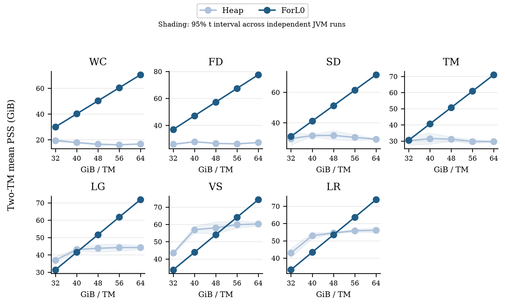

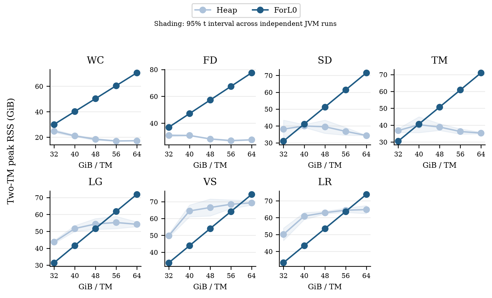

正式窗口结束后暂停所有源并排空管道，再在两TM执行Full GC，记录保留PSS/RSS和GC.heap_info。此时状态仍存活；该诊断完全处于性能/GC统计窗口之外。它描述静止保留进程占用，包含JIT、Flink、网络池及原生allocator保留页，仍不是精确的状态数据结构字节数。

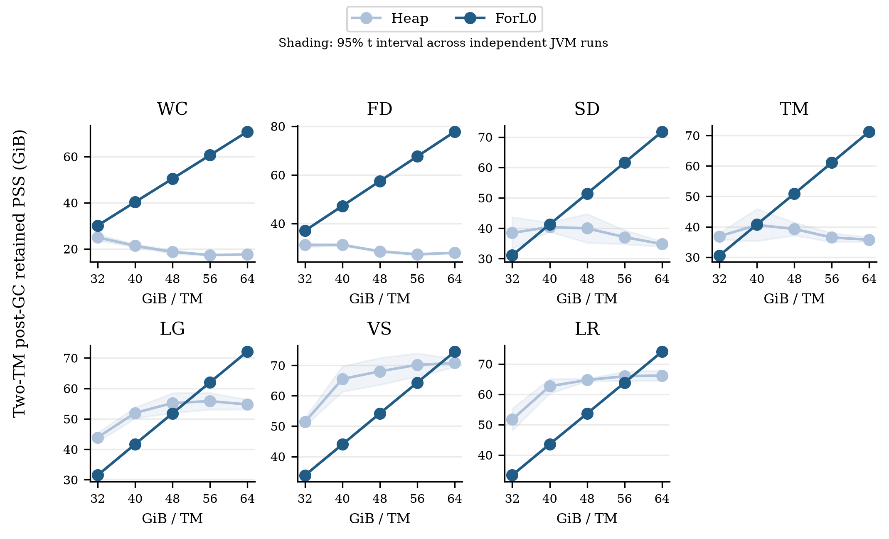

| workload | GiB/TM | 运行时平均PSS H/F GiB | 运行时峰值RSS H/F GiB | GC后保留PSS H/F GiB |
|---|---|---|---|---|
| WC | 32 | 19.42 / 30.03 | 24.85 / 30.07 | 24.95 / 30.11 |
| WC | 40 | 17.84 / 40.16 | 21.12 / 40.21 | 21.34 / 40.28 |
| WC | 48 | 16.50 / 50.25 | 18.44 / 50.28 | 18.67 / 50.39 |
| WC | 56 | 16.12 / 60.42 | 17.10 / 60.46 | 17.32 / 60.60 |
| WC | 64 | 16.72 / 70.56 | 17.29 / 70.58 | 17.58 / 70.78 |
| FD | 32 | 25.98 / 36.97 | 30.95 / 37.02 | 31.20 / 37.06 |
| FD | 40 | 27.83 / 47.12 | 30.92 / 47.17 | 31.20 / 47.23 |
| FD | 48 | 26.63 / 57.26 | 28.33 / 57.29 | 28.59 / 57.40 |
| FD | 56 | 26.30 / 67.40 | 27.07 / 67.43 | 27.33 / 67.58 |
| FD | 64 | 27.24 / 77.52 | 27.68 / 77.55 | 27.99 / 77.73 |
| SD | 32 | 29.51 / 30.97 | 38.14 / 31.00 | 38.47 / 31.09 |
| SD | 40 | 31.55 / 41.11 | 39.99 / 41.15 | 40.38 / 41.27 |
| SD | 48 | 31.67 / 51.21 | 39.54 / 51.24 | 39.96 / 51.39 |
| SD | 56 | 30.32 / 61.36 | 36.82 / 61.39 | 37.07 / 61.57 |
| SD | 64 | 29.19 / 71.50 | 34.35 / 71.53 | 34.79 / 71.74 |
| TM | 32 | 30.16 / 30.47 | 36.78 / 30.51 | 36.87 / 30.59 |
| TM | 40 | 31.46 / 40.62 | 40.25 / 40.66 | 40.60 / 40.77 |
| TM | 48 | 31.16 / 50.72 | 38.88 / 50.75 | 39.28 / 50.89 |
| TM | 56 | 29.71 / 60.85 | 36.22 / 60.88 | 36.49 / 61.07 |
| TM | 64 | 29.63 / 71.01 | 35.34 / 71.03 | 35.76 / 71.26 |
| LG | 32 | 36.92 / 31.40 | 43.69 / 31.44 | 43.91 / 31.48 |
| LG | 40 | 43.11 / 41.55 | 51.68 / 41.60 | 51.94 / 41.68 |
| LG | 48 | 43.79 / 51.65 | 54.38 / 51.68 | 55.20 / 51.80 |
| LG | 56 | 44.25 / 61.78 | 55.24 / 61.81 | 55.82 / 61.97 |
| LG | 64 | 44.20 / 71.92 | 54.20 / 71.94 | 54.72 / 72.13 |
| VS | 32 | 43.43 / 33.72 | 49.78 / 33.75 | 51.36 / 33.82 |
| VS | 40 | 56.89 / 43.86 | 64.50 / 43.89 | 65.52 / 43.99 |
| VS | 48 | 58.01 / 54.02 | 66.54 / 54.05 | 68.02 / 54.18 |
| VS | 56 | 59.80 / 64.12 | 68.46 / 64.15 | 70.16 / 64.31 |
| VS | 64 | 60.27 / 74.27 | 69.30 / 74.29 | 70.77 / 74.49 |
| LR | 32 | 42.96 / 33.26 | 50.13 / 33.30 | 51.67 / 33.35 |
| LR | 40 | 52.96 / 43.41 | 60.95 / 43.44 | 62.64 / 43.54 |
| LR | 48 | 54.54 / 53.48 | 62.99 / 53.51 | 64.68 / 53.64 |
| LR | 56 | 55.81 / 63.60 | 64.43 / 63.64 | 65.93 / 63.80 |
| LR | 64 | 56.07 / 73.78 | 64.80 / 73.81 | 66.17 / 74.01 |

更大Xmx可能允许更多短命对象留在已触碰的堆页中，因此运行时RSS增加不等于状态变大。压缩引用、类指针和G1 region可能随堆尺寸改变；内存梯度是这些JVM自动决策共同作用下的实际敏感性实验，不能只归因于GC容量。ForL0页、primitive布局和读缓存也有空间成本；本组端到端作业不使用ListState，不能用List缓存收益解释其footprint。

GC后保留进程占用仍包含空闲但已提交/驻留的Java堆页，尤其Xms=Xmx时不能把它当作“只有活对象”的内存量。另保存的GC.heap_info used更接近GC后Java堆内的存活占用，但仍含Flink运行时，且不包含ForL0原生状态。

| workload | GiB/TM | 后端 | 两TM GC后heap-used GiB | JM运行时RSS GiB | JM+2TM平均PSS GiB |
|---|---|---|---|---|---|
| WC | 32 | heap | 2.189 | 0.716 | 20.12 |
| WC | 32 | forl0 | 0.071 | 0.722 | 30.74 |
| WC | 64 | heap | 3.014 | 0.712 | 17.42 |
| WC | 64 | forl0 | 0.163 | 0.729 | 71.28 |
| FD | 32 | heap | 9.198 | 0.711 | 26.69 |
| FD | 32 | forl0 | 0.085 | 0.692 | 37.65 |
| FD | 64 | heap | 13.195 | 0.702 | 27.94 |
| FD | 64 | forl0 | 0.131 | 0.715 | 78.23 |
| SD | 32 | heap | 4.880 | 0.734 | 30.23 |
| SD | 32 | forl0 | 0.105 | 0.727 | 31.69 |
| SD | 64 | heap | 6.757 | 0.720 | 29.90 |
| SD | 64 | forl0 | 0.133 | 0.728 | 72.22 |
| TM | 32 | heap | 4.355 | 0.728 | 30.88 |
| TM | 32 | forl0 | 0.092 | 0.707 | 31.17 |
| TM | 64 | heap | 6.034 | 0.720 | 30.34 |
| TM | 64 | forl0 | 0.200 | 0.707 | 71.72 |
| LG | 32 | heap | 8.621 | 0.820 | 37.73 |
| LG | 32 | forl0 | 0.147 | 0.808 | 32.20 |
| LG | 64 | heap | 11.922 | 0.830 | 45.03 |
| LG | 64 | forl0 | 0.212 | 0.809 | 72.72 |
| VS | 32 | heap | 19.185 | 0.873 | 44.29 |
| VS | 32 | forl0 | 0.188 | 0.869 | 34.58 |
| VS | 64 | heap | 26.565 | 0.862 | 61.12 |
| VS | 64 | forl0 | 0.324 | 0.854 | 75.11 |
| LR | 32 | heap | 17.090 | 0.850 | 43.80 |
| LR | 32 | forl0 | 0.158 | 0.865 | 34.11 |
| LR | 64 | heap | 23.648 | 0.862 | 56.93 |
| LR | 64 | forl0 | 0.395 | 0.854 | 74.63 |

计时后`retained-class-histogram.txt`还记录了真实Java对象图（包括Long、HashMap节点/桶数组、Flink状态条目及运行时对象）。该诊断发生在保留内存快照之后，不进入稳态计时。对象图的减少可解释GC存活扫描/引用维护的变化，但不能单凭Java histogram推导ForL0的完整原生字节数。

| workload | GiB/TM | 后端 | Long对象GiB | HashMap节点GiB | HashMap桶数组GiB | 三类/GC后heap used |
|---|---|---|---|---|---|---|
| WC | 32 | heap | 0.762 | 1.001 | 0.258 | 92.3% |
| WC | 32 | forl0 | 0.000 | 0.001 | 0.000 | 2.0% |
| WC | 64 | heap | 0.762 | 1.501 | 0.513 | 92.1% |
| WC | 64 | forl0 | 0.000 | 0.001 | 0.001 | 1.4% |
| FD | 32 | heap | 2.449 | 5.251 | 1.266 | 97.5% |
| FD | 32 | forl0 | 0.000 | 0.001 | 0.000 | 1.5% |
| FD | 64 | heap | 2.449 | 7.876 | 2.524 | 97.4% |
| FD | 64 | forl0 | 0.000 | 0.001 | 0.001 | 1.6% |
| SD | 32 | heap | 1.699 | 2.251 | 0.586 | 93.0% |
| SD | 32 | forl0 | 0.000 | 0.001 | 0.000 | 1.4% |
| SD | 64 | heap | 1.699 | 3.376 | 1.161 | 92.3% |
| SD | 64 | forl0 | 0.000 | 0.001 | 0.001 | 1.8% |
| TM | 32 | heap | 1.547 | 2.001 | 0.516 | 93.3% |
| TM | 32 | forl0 | 0.000 | 0.001 | 0.000 | 1.5% |
| TM | 64 | heap | 1.547 | 3.001 | 1.024 | 92.3% |
| TM | 64 | forl0 | 0.000 | 0.001 | 0.001 | 1.1% |
| LG | 32 | heap | 3.093 | 4.001 | 1.032 | 94.3% |
| LG | 32 | forl0 | 0.000 | 0.001 | 0.001 | 1.4% |
| LG | 64 | heap | 3.093 | 6.002 | 2.048 | 93.5% |
| LG | 64 | forl0 | 0.000 | 0.002 | 0.001 | 1.5% |
| VS | 32 | heap | 6.890 | 9.002 | 2.321 | 94.9% |
| VS | 32 | forl0 | 0.000 | 0.002 | 0.001 | 1.6% |
| VS | 64 | heap | 6.891 | 13.503 | 4.607 | 94.1% |
| VS | 64 | forl0 | 0.000 | 0.003 | 0.002 | 1.6% |
| LR | 32 | heap | 6.147 | 8.002 | 2.063 | 94.9% |
| LR | 32 | forl0 | 0.000 | 0.002 | 0.001 | 1.8% |
| LR | 64 | heap | 6.152 | 12.003 | 4.095 | 94.1% |
| LR | 64 | forl0 | 0.000 | 0.003 | 0.002 | 1.2% |

Histogram统计的是这些类的浅对象字节总和，包含相同类的少量框架对象，不是严格的状态对象所有权划分。对Long feature，Heap的值对象、Map节点与桶数组构成主要保留图；ForL0的primitive数据位于原生内存，所以不能把其较少的Java对象直接表述为相同倍数的总内存节省。

### 5.1 为什么ForL0的PSS随配置预算近似线性增长

GC日志与实际VM.flags显示，默认G1年轻代上限为Java堆的60%；ForL0计时窗口内的Eden目标接近该上限。随着Flink进程预算增大，Xms=Xmx也增大，Eden因而按近似固定比例增长。处理过程填满这些年轻代区域后，页成为真实物理驻留；收集掉临时对象不等于将驻留页归还OS。状态实体/feature数量没有随预算变化。[Java11参数定义](https://docs.oracle.com/en/java/javase/11/tools/java.html)、原始flags与GC日志共同支持该解释。

| WC ForL0 GiB/TM | Xmx/TM GiB | 计时内两TM Eden目标GiB | 运行时两TM平均PSS GiB | 诊断时Java堆驻留RSS界限GiB | GC后Java heap-used GiB |
|---|---|---|---|---|---|
| 32 | 22.125 | 26.53 | 30.03 | [26.62, 26.62] | 0.071 |
| 40 | 30.125 | 36.12 | 40.16 | [36.19, 36.19] | 0.107 |
| 48 | 38.125 | 45.72 | 50.25 | [45.66, 48.08] | 0.189 |
| 56 | 46.125 | 55.31 | 60.42 | [55.22, 58.15] | 0.158 |
| 64 | 54.125 | 64.91 | 70.56 | [64.79, 67.62] | 0.163 |

WC的GC后诊断RSS由30.15增加至70.81GiB；增加的40.66GiB中，Java堆驻留增量下界为38.17GiB，即约93.9%。这一结果直接定位大部分额外驻留页在Java堆中，不能用状态实体增加解释，也不是完整原生状态字节数的测量。

Java堆驻留界限来自另外保存的retained-numa-maps.gz和GC.heap_info地址范围：统计每个VMA的驻留页；与Java堆边界合并的VMA按地址跨度给出保守上下界，避免把整段匿名映射误算为某一方。该快照在暂停/排空、Full GC和histogram之后，和计时窗口PSS不是完全同一时刻；界限是RSS而非PSS，不能直接相减得到原生状态字节数。[逐次诊断与算法说明](analysis/memory-mechanism.json)。

ForL0较少的长期Java对象图及较轻的收集工作，使G1可以选择更大的年轻代；Heap则受到暂停目标和存活/引用图处理成本约束，计时内Eden通常更小。这不是原生状态按Xmx增长的证据，也不能把高PSS从实际物理成本中删掉。剩余非Java堆驻留部分还包含JVM的GC元数据、代码、线程栈、Flink缓冲和原生分配器，不能全部归属ForL0状态。

## 6. 详细归因：GC、状态访问与其他工作

GC工作线程CPU由/proc计数直接获得。状态CPU按每个非GC线程在精确窗口内的CPU栈占比乘该线程CPU时间估计；严格backend-frame分类与包含共同LongStateAccess循环的分类均保留。主图采用后者，包含循环算术、装箱及mutator写屏障。其他CPU为过程总CPU减前两项，包括网络、序列化、调度、JIT和未归入状态的工作。JFR只裁剪目标120s窗口，线程标题不参与状态frame匹配。

三项互斥是**CPU记账定义**，不是互相独立的墙钟因果效应。GC写屏障可能落在mutator状态路径中；状态布局改变又会影响GC，两项存在机制联系。不能把采样状态比例乘作业墙钟、也不能将GC CPU秒当作暂停秒。

GC专用线程以名称识别；VM Thread等非专用线程中的部分GC工作可能落在“其他”，因此GC worker CPU不是全部GC相关开销。主分解统计两TM；JM的配置、CPU计数、亲和性与内存另行保存，未混入八核worker分解。

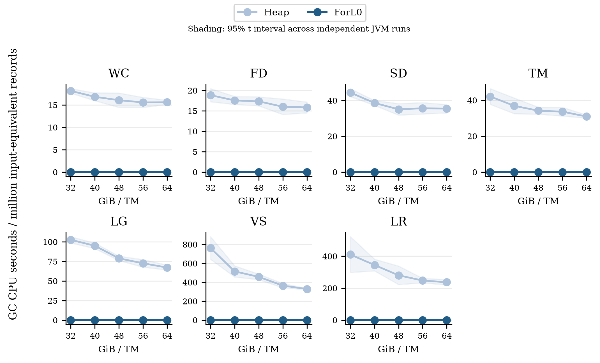

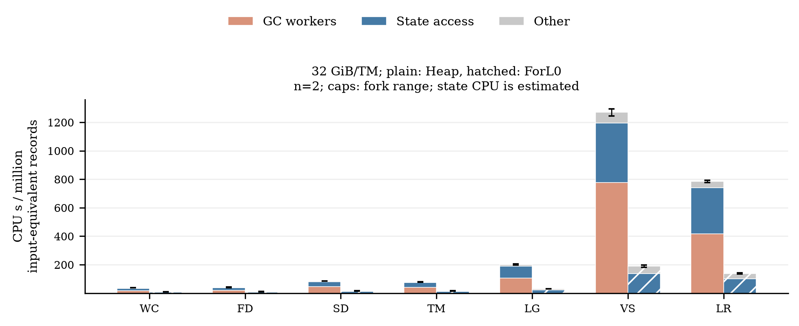

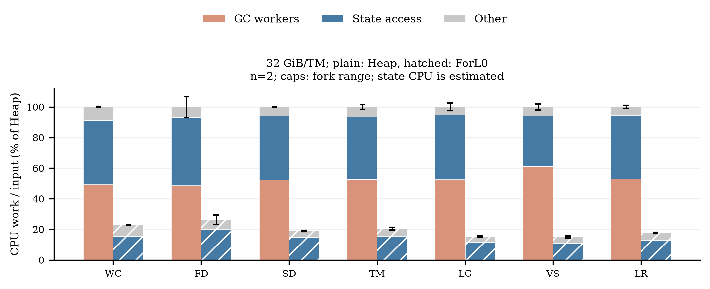

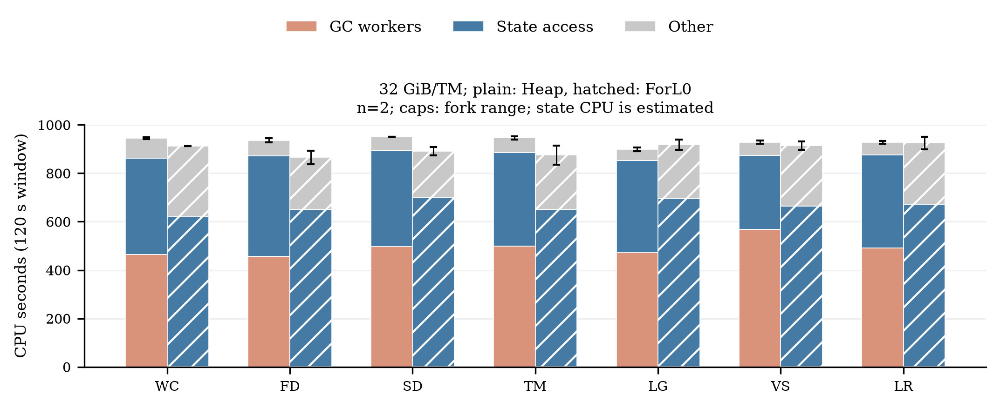

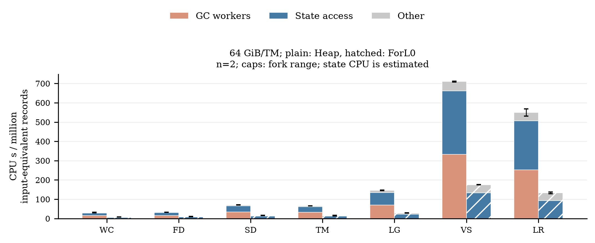

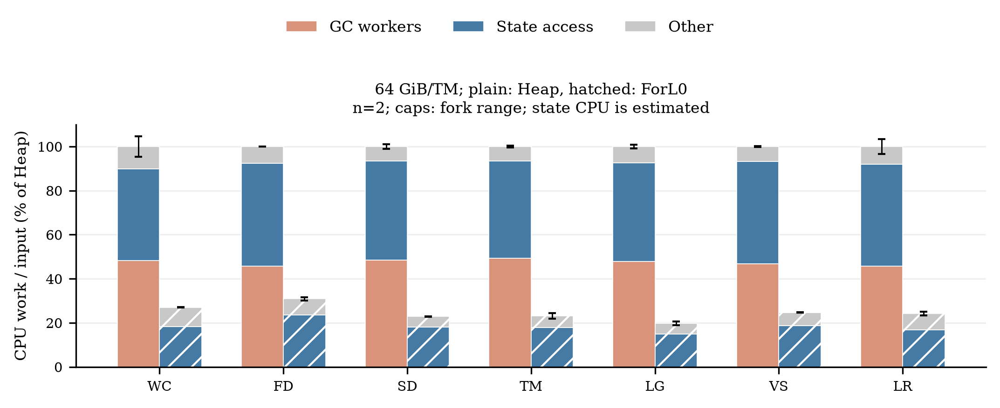

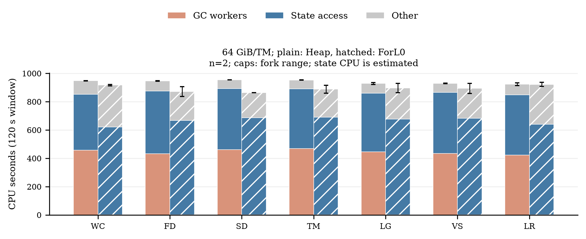

原始CPU秒图中ForL0的状态CPU可能更大，因为同一120s内完成更多记录；访问效率应结合单位输入图判断。相对图以同workload的Heap单位输入总CPU为100%，各组件仍按同一分母归一化。八核CPU等效时间及未用容量项也保存在分析JSON，不能视为独立测出的串行因果时间。

| workload | GiB/TM | 后端 | GC CPU s/M | 状态CPU s/M（估计） | 其他CPU s/M（估计） | 平均使用核数 | 120s内STW并集s |
|---|---|---|---|---|---|---|---|
| WC | 32 | heap | 18.39 | 15.65 | 3.27 | 7.87 | 33.697 |
| WC | 32 | forl0 | 0.01 | 5.79 | 2.72 | 7.60 | 0.232 |
| WC | 64 | heap | 15.31 | 13.21 | 3.21 | 7.89 | 21.141 |
| WC | 64 | forl0 | 0.01 | 5.80 | 2.76 | 7.64 | 0.166 |
| FD | 32 | heap | 19.66 | 17.95 | 2.74 | 7.80 | 35.180 |
| FD | 32 | forl0 | 0.01 | 7.98 | 2.57 | 7.21 | 0.178 |
| FD | 64 | heap | 15.12 | 15.50 | 2.51 | 7.89 | 18.681 |
| FD | 64 | forl0 | 0.01 | 7.83 | 2.41 | 7.26 | 0.138 |
| SD | 32 | heap | 45.01 | 36.11 | 5.05 | 7.93 | 53.177 |
| SD | 32 | forl0 | 0.02 | 12.78 | 3.53 | 7.43 | 0.224 |
| SD | 64 | heap | 33.88 | 31.53 | 4.56 | 7.95 | 38.349 |
| SD | 64 | forl0 | 0.02 | 12.69 | 3.27 | 7.19 | 0.161 |
| TM | 32 | heap | 41.57 | 32.08 | 5.07 | 7.89 | 57.621 |
| TM | 32 | forl0 | 0.02 | 11.92 | 4.10 | 7.30 | 0.226 |
| TM | 64 | heap | 32.48 | 29.16 | 4.33 | 7.94 | 41.846 |
| TM | 64 | forl0 | 0.02 | 11.83 | 3.38 | 7.40 | 0.157 |
| LG | 32 | heap | 105.69 | 85.05 | 10.62 | 7.50 | 61.518 |
| LG | 32 | forl0 | 0.04 | 23.14 | 7.44 | 7.65 | 0.267 |
| LG | 64 | heap | 69.95 | 65.14 | 10.83 | 7.74 | 48.588 |
| LG | 64 | forl0 | 0.04 | 21.82 | 7.05 | 7.47 | 0.179 |
| VS | 32 | heap | 777.33 | 418.90 | 74.17 | 7.74 | 72.157 |
| VS | 32 | forl0 | 0.27 | 138.04 | 52.19 | 7.62 | 0.262 |
| VS | 64 | heap | 332.30 | 329.60 | 48.26 | 7.75 | 65.464 |
| VS | 64 | forl0 | 0.23 | 133.31 | 41.77 | 7.45 | 0.194 |
| LR | 32 | heap | 415.62 | 324.76 | 44.67 | 7.73 | 60.930 |
| LR | 32 | forl0 | 0.19 | 100.44 | 37.75 | 7.71 | 0.276 |
| LR | 64 | heap | 251.82 | 254.00 | 43.87 | 7.69 | 56.496 |
| LR | 64 | forl0 | 0.17 | 92.58 | 40.43 | 7.69 | 0.201 |

| workload | GiB/TM | 后端 | refinement CPU s/M | 并行GC worker s/M | 并发标记CPU s/M | 其余GC worker s/M |
|---|---|---|---|---|---|---|
| WC | 32 | heap | 10.82 | 7.31 | 0.00 | 0.03 |
| WC | 32 | forl0 | 0.00 | 0.01 | 0.00 | 0.00 |
| WC | 64 | heap | 11.43 | 4.16 | 0.00 | 0.02 |
| WC | 64 | forl0 | 0.00 | 0.00 | 0.00 | 0.00 |
| FD | 32 | heap | 10.79 | 8.01 | 0.00 | 0.05 |
| FD | 32 | forl0 | 0.00 | 0.01 | 0.00 | 0.00 |
| FD | 64 | heap | 12.04 | 3.76 | 0.00 | 0.04 |
| FD | 64 | forl0 | 0.00 | 0.01 | 0.00 | 0.01 |
| SD | 32 | heap | 19.69 | 22.50 | 2.10 | 0.09 |
| SD | 32 | forl0 | 0.00 | 0.01 | 0.00 | 0.01 |
| SD | 64 | heap | 20.59 | 14.75 | 0.00 | 0.08 |
| SD | 64 | forl0 | 0.00 | 0.01 | 0.00 | 0.01 |
| TM | 32 | heap | 17.91 | 22.07 | 2.04 | 0.08 |
| TM | 32 | forl0 | 0.00 | 0.01 | 0.00 | 0.01 |
| TM | 64 | heap | 15.29 | 15.59 | 0.00 | 0.06 |
| TM | 64 | forl0 | 0.00 | 0.01 | 0.00 | 0.01 |
| LG | 32 | heap | 36.34 | 53.86 | 12.06 | 0.38 |
| LG | 32 | forl0 | 0.00 | 0.03 | 0.00 | 0.01 |
| LG | 64 | heap | 24.92 | 42.05 | 0.00 | 0.25 |
| LG | 64 | forl0 | 0.00 | 0.02 | 0.00 | 0.01 |
| VS | 32 | heap | 156.68 | 507.08 | 97.11 | 2.08 |
| VS | 32 | forl0 | 0.00 | 0.18 | 0.00 | 0.07 |
| VS | 64 | heap | 124.24 | 202.43 | 0.61 | 1.77 |
| VS | 64 | forl0 | 0.00 | 0.13 | 0.00 | 0.09 |
| LR | 32 | heap | 108.53 | 224.85 | 75.54 | 1.48 |
| LR | 32 | forl0 | 0.00 | 0.13 | 0.00 | 0.06 |
| LR | 64 | heap | 89.83 | 146.26 | 0.00 | 1.11 |
| LR | 64 | forl0 | 0.00 | 0.10 | 0.00 | 0.06 |

以上GC子类来自无profiler主运行的线程计数。refinement反映G1记忆集维护工作；并行GC worker可参与不同收集阶段，不能仅凭线程名称将其全部解释为某一种暂停。若Heap的节点/Long保留图、refinement与暂停同时较大，而ForL0减少这些工作，证据支持减少托管堆引用维护这一机制；准确份额仍按上述CPU记账定义解释。

对相同工作量的CPU节省，采用每百万输入CPU差值分解；GC/状态/其他三项之和严格等于总CPU差值。占比可为负值或超过100%，应原样解释，不能强制得到漂亮的正贡献。吞吐比还受平均使用核数影响：`TP_F/TP_H = (CPU_per_input_H/CPU_per_input_F) × (cores_F/cores_H)`。它是测量恒等式，不是独立优化的消融实验。

| workload | GiB/TM | 总CPU节省s/M | GC节省及占比 | 状态节省及占比 | 其他节省及占比 |
|---|---|---|---|---|---|
| WC | 32 | 28.79 | 18.38 (63.8%) | 9.86 (34.3%) | 0.55 (1.9%) |
| WC | 64 | 23.15 | 15.30 (66.1%) | 7.41 (32.0%) | 0.45 (1.9%) |
| FD | 32 | 29.79 | 19.65 (66.0%) | 9.97 (33.5%) | 0.17 (0.6%) |
| FD | 64 | 22.88 | 15.11 (66.0%) | 7.67 (33.5%) | 0.10 (0.4%) |
| SD | 32 | 69.84 | 44.99 (64.4%) | 23.33 (33.4%) | 1.52 (2.2%) |
| SD | 64 | 53.98 | 33.86 (62.7%) | 18.84 (34.9%) | 1.29 (2.4%) |
| TM | 32 | 62.67 | 41.55 (66.3%) | 20.16 (32.2%) | 0.97 (1.5%) |
| TM | 64 | 50.74 | 32.47 (64.0%) | 17.33 (34.2%) | 0.95 (1.9%) |
| LG | 32 | 170.73 | 105.65 (61.9%) | 61.90 (36.3%) | 3.18 (1.9%) |
| LG | 64 | 117.01 | 69.92 (59.8%) | 43.32 (37.0%) | 3.78 (3.2%) |
| VS | 32 | 1079.90 | 777.07 (72.0%) | 280.86 (26.0%) | 21.98 (2.0%) |
| VS | 64 | 534.86 | 332.07 (62.1%) | 196.30 (36.7%) | 6.49 (1.2%) |
| LR | 32 | 646.66 | 415.43 (64.2%) | 224.31 (34.7%) | 6.91 (1.1%) |
| LR | 64 | 416.52 | 251.65 (60.4%) | 161.42 (38.8%) | 3.45 (0.8%) |

在14个归因条件中，包含共同访问循环的单位输入状态路径CPU代价，Heap/ForL0估计比为1.98–3.67。这提供了GC worker之外的状态路径成本下降证据；其中仍含mutator屏障和装箱等成本，不应全部解释为单次原生查表指令的加速。

以WC、32GiB/TM为例，每百万输入的CPU工作量为Heap 37.32s、ForL0 8.53s。节省的28.79CPU秒中，GC worker占63.8%，状态路径占34.3%，其他占1.9%。两者平均使用7.87/7.60核，可用上限均为8；这些百分比描述CPU节省来源，不是墙钟提速的独立因果份额。

以VS、32GiB/TM为例，每百万输入的CPU工作量为Heap 1270.40s、ForL0 190.50s。节省的1079.90CPU秒中，GC worker占72.0%，状态路径占26.0%，其他占2.0%。两者平均使用7.74/7.62核，可用上限均为8；这些百分比描述CPU节省来源，不是墙钟提速的独立因果份额。

每个归因条件仅两个独立运行，完整样本、CPU校准因子、采样覆盖率、严格状态分类和火焰图均保留；不把二次采样误差包装成确定因果贡献。与主计时的吞吐差异用于检查profiler干扰，诊断数据不并入主图。

| workload | GiB/TM | 后端 | 最小非GC CPU采样覆盖 | 严格/包含循环状态CPU s | profile/无profile吞吐变化 |
|---|---|---|---|---|---|
| WC | 32 | heap | 99.9% | 333.15 / 396.31 | -2.0% |
| WC | 32 | forl0 | 100.0% | 399.21 / 619.74 | +4.1% |
| WC | 64 | heap | 99.9% | 325.22 / 393.42 | +5.5% |
| WC | 64 | forl0 | 100.0% | 392.43 / 620.48 | -2.4% |
| FD | 32 | heap | 99.9% | 359.30 / 415.52 | -6.6% |
| FD | 32 | forl0 | 100.0% | 562.35 / 649.22 | -4.1% |
| FD | 64 | heap | 99.9% | 376.71 / 443.05 | +6.6% |
| FD | 64 | forl0 | 99.9% | 502.36 / 665.44 | -1.4% |
| SD | 32 | heap | 99.9% | 337.72 / 398.55 | +0.4% |
| SD | 32 | forl0 | 99.9% | 530.43 / 697.70 | -4.1% |
| SD | 64 | heap | 99.9% | 359.11 / 429.89 | +3.3% |
| SD | 64 | forl0 | 99.9% | 500.78 / 685.43 | -2.2% |
| TM | 32 | heap | 99.8% | 321.08 / 385.60 | +0.7% |
| TM | 32 | forl0 | 99.9% | 458.04 / 650.58 | -5.2% |
| TM | 64 | heap | 99.9% | 352.51 / 421.16 | -4.1% |
| TM | 64 | forl0 | 100.0% | 476.08 / 689.61 | +5.5% |
| LG | 32 | heap | 99.8% | 328.08 / 379.62 | -2.9% |
| LG | 32 | forl0 | 99.9% | 542.78 / 693.52 | +2.4% |
| LG | 64 | heap | 99.8% | 346.27 / 414.50 | -0.7% |
| LG | 64 | forl0 | 99.9% | 532.92 / 676.48 | -4.1% |
| VS | 32 | heap | 99.6% | 269.44 / 305.74 | -1.8% |
| VS | 32 | forl0 | 99.9% | 475.98 / 662.50 | -11.1% |
| VS | 64 | heap | 99.7% | 358.42 / 431.41 | +0.9% |
| VS | 64 | forl0 | 99.9% | 484.61 / 680.68 | -6.2% |
| LR | 32 | heap | 99.7% | 330.41 / 383.60 | -2.3% |
| LR | 32 | forl0 | 99.9% | 512.54 / 671.50 | -1.7% |
| LR | 64 | heap | 99.8% | 361.76 / 426.51 | -6.8% |
| LR | 64 | forl0 | 99.9% | 484.04 / 639.52 | -8.5% |

| 归因样本 | CPU火焰图TM1 | CPU火焰图TM2 | 校准后原始分析 |
|---|---|---|---|
| fd 32GiB forl0 r1 | [HTML](profiles/fd-m32-forl0-r1/tm1-cpu.html) | [HTML](profiles/fd-m32-forl0-r1/tm2-cpu.html) | [JSON](profiles/fd-m32-forl0-r1/analysis.json) |
| fd 32GiB forl0 r2 | [HTML](profiles/fd-m32-forl0-r2/tm1-cpu.html) | [HTML](profiles/fd-m32-forl0-r2/tm2-cpu.html) | [JSON](profiles/fd-m32-forl0-r2/analysis.json) |
| fd 32GiB heap r1 | [HTML](profiles/fd-m32-heap-r1/tm1-cpu.html) | [HTML](profiles/fd-m32-heap-r1/tm2-cpu.html) | [JSON](profiles/fd-m32-heap-r1/analysis.json) |
| fd 32GiB heap r2 | [HTML](profiles/fd-m32-heap-r2/tm1-cpu.html) | [HTML](profiles/fd-m32-heap-r2/tm2-cpu.html) | [JSON](profiles/fd-m32-heap-r2/analysis.json) |
| fd 64GiB forl0 r1 | [HTML](profiles/fd-m64-forl0-r1/tm1-cpu.html) | [HTML](profiles/fd-m64-forl0-r1/tm2-cpu.html) | [JSON](profiles/fd-m64-forl0-r1/analysis.json) |
| fd 64GiB forl0 r2 | [HTML](profiles/fd-m64-forl0-r2/tm1-cpu.html) | [HTML](profiles/fd-m64-forl0-r2/tm2-cpu.html) | [JSON](profiles/fd-m64-forl0-r2/analysis.json) |
| fd 64GiB heap r1 | [HTML](profiles/fd-m64-heap-r1/tm1-cpu.html) | [HTML](profiles/fd-m64-heap-r1/tm2-cpu.html) | [JSON](profiles/fd-m64-heap-r1/analysis.json) |
| fd 64GiB heap r2 | [HTML](profiles/fd-m64-heap-r2/tm1-cpu.html) | [HTML](profiles/fd-m64-heap-r2/tm2-cpu.html) | [JSON](profiles/fd-m64-heap-r2/analysis.json) |
| lg 32GiB forl0 r1 | [HTML](profiles/lg-m32-forl0-r1/tm1-cpu.html) | [HTML](profiles/lg-m32-forl0-r1/tm2-cpu.html) | [JSON](profiles/lg-m32-forl0-r1/analysis.json) |
| lg 32GiB forl0 r2 | [HTML](profiles/lg-m32-forl0-r2/tm1-cpu.html) | [HTML](profiles/lg-m32-forl0-r2/tm2-cpu.html) | [JSON](profiles/lg-m32-forl0-r2/analysis.json) |
| lg 32GiB heap r1 | [HTML](profiles/lg-m32-heap-r1/tm1-cpu.html) | [HTML](profiles/lg-m32-heap-r1/tm2-cpu.html) | [JSON](profiles/lg-m32-heap-r1/analysis.json) |
| lg 32GiB heap r2 | [HTML](profiles/lg-m32-heap-r2/tm1-cpu.html) | [HTML](profiles/lg-m32-heap-r2/tm2-cpu.html) | [JSON](profiles/lg-m32-heap-r2/analysis.json) |
| lg 64GiB forl0 r1 | [HTML](profiles/lg-m64-forl0-r1/tm1-cpu.html) | [HTML](profiles/lg-m64-forl0-r1/tm2-cpu.html) | [JSON](profiles/lg-m64-forl0-r1/analysis.json) |
| lg 64GiB forl0 r2 | [HTML](profiles/lg-m64-forl0-r2/tm1-cpu.html) | [HTML](profiles/lg-m64-forl0-r2/tm2-cpu.html) | [JSON](profiles/lg-m64-forl0-r2/analysis.json) |
| lg 64GiB heap r1 | [HTML](profiles/lg-m64-heap-r1/tm1-cpu.html) | [HTML](profiles/lg-m64-heap-r1/tm2-cpu.html) | [JSON](profiles/lg-m64-heap-r1/analysis.json) |
| lg 64GiB heap r2 | [HTML](profiles/lg-m64-heap-r2/tm1-cpu.html) | [HTML](profiles/lg-m64-heap-r2/tm2-cpu.html) | [JSON](profiles/lg-m64-heap-r2/analysis.json) |
| lr 32GiB forl0 r1 | [HTML](profiles/lr-m32-forl0-r1/tm1-cpu.html) | [HTML](profiles/lr-m32-forl0-r1/tm2-cpu.html) | [JSON](profiles/lr-m32-forl0-r1/analysis.json) |
| lr 32GiB forl0 r2 | [HTML](profiles/lr-m32-forl0-r2/tm1-cpu.html) | [HTML](profiles/lr-m32-forl0-r2/tm2-cpu.html) | [JSON](profiles/lr-m32-forl0-r2/analysis.json) |
| lr 32GiB heap r1 | [HTML](profiles/lr-m32-heap-r1/tm1-cpu.html) | [HTML](profiles/lr-m32-heap-r1/tm2-cpu.html) | [JSON](profiles/lr-m32-heap-r1/analysis.json) |
| lr 32GiB heap r2 | [HTML](profiles/lr-m32-heap-r2/tm1-cpu.html) | [HTML](profiles/lr-m32-heap-r2/tm2-cpu.html) | [JSON](profiles/lr-m32-heap-r2/analysis.json) |
| lr 64GiB forl0 r1 | [HTML](profiles/lr-m64-forl0-r1/tm1-cpu.html) | [HTML](profiles/lr-m64-forl0-r1/tm2-cpu.html) | [JSON](profiles/lr-m64-forl0-r1/analysis.json) |
| lr 64GiB forl0 r2 | [HTML](profiles/lr-m64-forl0-r2/tm1-cpu.html) | [HTML](profiles/lr-m64-forl0-r2/tm2-cpu.html) | [JSON](profiles/lr-m64-forl0-r2/analysis.json) |
| lr 64GiB heap r1 | [HTML](profiles/lr-m64-heap-r1/tm1-cpu.html) | [HTML](profiles/lr-m64-heap-r1/tm2-cpu.html) | [JSON](profiles/lr-m64-heap-r1/analysis.json) |
| lr 64GiB heap r2 | [HTML](profiles/lr-m64-heap-r2/tm1-cpu.html) | [HTML](profiles/lr-m64-heap-r2/tm2-cpu.html) | [JSON](profiles/lr-m64-heap-r2/analysis.json) |
| sd 32GiB forl0 r1 | [HTML](profiles/sd-m32-forl0-r1/tm1-cpu.html) | [HTML](profiles/sd-m32-forl0-r1/tm2-cpu.html) | [JSON](profiles/sd-m32-forl0-r1/analysis.json) |
| sd 32GiB forl0 r2 | [HTML](profiles/sd-m32-forl0-r2/tm1-cpu.html) | [HTML](profiles/sd-m32-forl0-r2/tm2-cpu.html) | [JSON](profiles/sd-m32-forl0-r2/analysis.json) |
| sd 32GiB heap r1 | [HTML](profiles/sd-m32-heap-r1/tm1-cpu.html) | [HTML](profiles/sd-m32-heap-r1/tm2-cpu.html) | [JSON](profiles/sd-m32-heap-r1/analysis.json) |
| sd 32GiB heap r2 | [HTML](profiles/sd-m32-heap-r2/tm1-cpu.html) | [HTML](profiles/sd-m32-heap-r2/tm2-cpu.html) | [JSON](profiles/sd-m32-heap-r2/analysis.json) |
| sd 64GiB forl0 r1 | [HTML](profiles/sd-m64-forl0-r1/tm1-cpu.html) | [HTML](profiles/sd-m64-forl0-r1/tm2-cpu.html) | [JSON](profiles/sd-m64-forl0-r1/analysis.json) |
| sd 64GiB forl0 r2 | [HTML](profiles/sd-m64-forl0-r2/tm1-cpu.html) | [HTML](profiles/sd-m64-forl0-r2/tm2-cpu.html) | [JSON](profiles/sd-m64-forl0-r2/analysis.json) |
| sd 64GiB heap r1 | [HTML](profiles/sd-m64-heap-r1/tm1-cpu.html) | [HTML](profiles/sd-m64-heap-r1/tm2-cpu.html) | [JSON](profiles/sd-m64-heap-r1/analysis.json) |
| sd 64GiB heap r2 | [HTML](profiles/sd-m64-heap-r2/tm1-cpu.html) | [HTML](profiles/sd-m64-heap-r2/tm2-cpu.html) | [JSON](profiles/sd-m64-heap-r2/analysis.json) |
| tm 32GiB forl0 r1 | [HTML](profiles/tm-m32-forl0-r1/tm1-cpu.html) | [HTML](profiles/tm-m32-forl0-r1/tm2-cpu.html) | [JSON](profiles/tm-m32-forl0-r1/analysis.json) |
| tm 32GiB forl0 r2 | [HTML](profiles/tm-m32-forl0-r2/tm1-cpu.html) | [HTML](profiles/tm-m32-forl0-r2/tm2-cpu.html) | [JSON](profiles/tm-m32-forl0-r2/analysis.json) |
| tm 32GiB heap r1 | [HTML](profiles/tm-m32-heap-r1/tm1-cpu.html) | [HTML](profiles/tm-m32-heap-r1/tm2-cpu.html) | [JSON](profiles/tm-m32-heap-r1/analysis.json) |
| tm 32GiB heap r2 | [HTML](profiles/tm-m32-heap-r2/tm1-cpu.html) | [HTML](profiles/tm-m32-heap-r2/tm2-cpu.html) | [JSON](profiles/tm-m32-heap-r2/analysis.json) |
| tm 64GiB forl0 r1 | [HTML](profiles/tm-m64-forl0-r1/tm1-cpu.html) | [HTML](profiles/tm-m64-forl0-r1/tm2-cpu.html) | [JSON](profiles/tm-m64-forl0-r1/analysis.json) |
| tm 64GiB forl0 r2 | [HTML](profiles/tm-m64-forl0-r2/tm1-cpu.html) | [HTML](profiles/tm-m64-forl0-r2/tm2-cpu.html) | [JSON](profiles/tm-m64-forl0-r2/analysis.json) |
| tm 64GiB heap r1 | [HTML](profiles/tm-m64-heap-r1/tm1-cpu.html) | [HTML](profiles/tm-m64-heap-r1/tm2-cpu.html) | [JSON](profiles/tm-m64-heap-r1/analysis.json) |
| tm 64GiB heap r2 | [HTML](profiles/tm-m64-heap-r2/tm1-cpu.html) | [HTML](profiles/tm-m64-heap-r2/tm2-cpu.html) | [JSON](profiles/tm-m64-heap-r2/analysis.json) |
| vs 32GiB forl0 r1 | [HTML](profiles/vs-m32-forl0-r1/tm1-cpu.html) | [HTML](profiles/vs-m32-forl0-r1/tm2-cpu.html) | [JSON](profiles/vs-m32-forl0-r1/analysis.json) |
| vs 32GiB forl0 r2 | [HTML](profiles/vs-m32-forl0-r2/tm1-cpu.html) | [HTML](profiles/vs-m32-forl0-r2/tm2-cpu.html) | [JSON](profiles/vs-m32-forl0-r2/analysis.json) |
| vs 32GiB heap r1 | [HTML](profiles/vs-m32-heap-r1/tm1-cpu.html) | [HTML](profiles/vs-m32-heap-r1/tm2-cpu.html) | [JSON](profiles/vs-m32-heap-r1/analysis.json) |
| vs 32GiB heap r2 | [HTML](profiles/vs-m32-heap-r2/tm1-cpu.html) | [HTML](profiles/vs-m32-heap-r2/tm2-cpu.html) | [JSON](profiles/vs-m32-heap-r2/analysis.json) |
| vs 64GiB forl0 r1 | [HTML](profiles/vs-m64-forl0-r1/tm1-cpu.html) | [HTML](profiles/vs-m64-forl0-r1/tm2-cpu.html) | [JSON](profiles/vs-m64-forl0-r1/analysis.json) |
| vs 64GiB forl0 r2 | [HTML](profiles/vs-m64-forl0-r2/tm1-cpu.html) | [HTML](profiles/vs-m64-forl0-r2/tm2-cpu.html) | [JSON](profiles/vs-m64-forl0-r2/analysis.json) |
| vs 64GiB heap r1 | [HTML](profiles/vs-m64-heap-r1/tm1-cpu.html) | [HTML](profiles/vs-m64-heap-r1/tm2-cpu.html) | [JSON](profiles/vs-m64-heap-r1/analysis.json) |
| vs 64GiB heap r2 | [HTML](profiles/vs-m64-heap-r2/tm1-cpu.html) | [HTML](profiles/vs-m64-heap-r2/tm2-cpu.html) | [JSON](profiles/vs-m64-heap-r2/analysis.json) |
| wc 32GiB forl0 r1 | [HTML](profiles/wc-m32-forl0-r1/tm1-cpu.html) | [HTML](profiles/wc-m32-forl0-r1/tm2-cpu.html) | [JSON](profiles/wc-m32-forl0-r1/analysis.json) |
| wc 32GiB forl0 r2 | [HTML](profiles/wc-m32-forl0-r2/tm1-cpu.html) | [HTML](profiles/wc-m32-forl0-r2/tm2-cpu.html) | [JSON](profiles/wc-m32-forl0-r2/analysis.json) |
| wc 32GiB heap r1 | [HTML](profiles/wc-m32-heap-r1/tm1-cpu.html) | [HTML](profiles/wc-m32-heap-r1/tm2-cpu.html) | [JSON](profiles/wc-m32-heap-r1/analysis.json) |
| wc 32GiB heap r2 | [HTML](profiles/wc-m32-heap-r2/tm1-cpu.html) | [HTML](profiles/wc-m32-heap-r2/tm2-cpu.html) | [JSON](profiles/wc-m32-heap-r2/analysis.json) |
| wc 64GiB forl0 r1 | [HTML](profiles/wc-m64-forl0-r1/tm1-cpu.html) | [HTML](profiles/wc-m64-forl0-r1/tm2-cpu.html) | [JSON](profiles/wc-m64-forl0-r1/analysis.json) |
| wc 64GiB forl0 r2 | [HTML](profiles/wc-m64-forl0-r2/tm1-cpu.html) | [HTML](profiles/wc-m64-forl0-r2/tm2-cpu.html) | [JSON](profiles/wc-m64-forl0-r2/analysis.json) |
| wc 64GiB heap r1 | [HTML](profiles/wc-m64-heap-r1/tm1-cpu.html) | [HTML](profiles/wc-m64-heap-r1/tm2-cpu.html) | [JSON](profiles/wc-m64-heap-r1/analysis.json) |
| wc 64GiB heap r2 | [HTML](profiles/wc-m64-heap-r2/tm1-cpu.html) | [HTML](profiles/wc-m64-heap-r2/tm2-cpu.html) | [JSON](profiles/wc-m64-heap-r2/analysis.json) |

## 7. 状态微基准：Heap / ForL0 R30 / RocksDB

Heap/ForL0直接复用已冻结R30的52个独立fork结果，不重跑、不重新挑选分数。RocksDB先完成26个短窗口fork，再统一追加18个加长写操作fork和2个充分预热的Map读取fork。最终图采用6个原读取fork、18个长写fork和2个长Map读fork；原短窗口完整保留为诊断。所有计时和fixture类来自同一个SHA-256为 `bc258cea2877431005b499210096217e0ca6adcd24ddcb142976c87c26ec6ad6` 的应用；新增覆盖层只含工厂/枚举及RocksDB构造helper。

| 参数 | 设置 |
|---|---|
| CPU/JVM | 整个JVM CPU4–7、ActiveProcessorCount4、Xms=Xmx8GiB、1 benchmark线程 |
| 数据 | 1,048,576实体；Long Value、16元素Long List、64对Long→Long Map；Map get/update每实体连续64次 |
| 调用 | 批次1024次标准API，OperationsPerInvocation1024；bulk按一次API调用计数 |
| 重复/时间 | 每后端2独立fork；普通项3×3s预热、5×3s测量；Value add为10×5s预热、5×5s测量 |
| RocksDB | Flink1.20.3 EmbeddedRocksDB，frocksdbjni6.20.3-ververica-2.0；DEFAULT options；共享native预算4GiB、write-buffer ratio0.5、high-priority pool0.1 |
| 内存口径 | 8GiB仅Java堆；ForL0和RocksDB另占原生内存，不声称总RSS同为8GiB |
| 采集时间 | Heap/ForL0为先前R30数据，RocksDB为本次补测；不是同时段三后端交错试验，较小差异需谨慎解释 |

上表原时间参数适用于Heap/ForL0及RocksDB的Value get、List get/iterate。RocksDB的9种写操作最终统一为24×5s预热、12×5s测量；Map get含67,108,864对键值，按初测速率完整访问约15.5分钟，因此另用240×5s预热、12×5s测量，以减少块缓存冷启动影响。每种最终配置均2fork。

微基准namespace为Void，backend覆盖key group0–1。初始Value为`BASE+k`，List第j项为`BASE+16k+j`，Map第j项为`BASE+64k+j`，BASE=1,000,000,007；批量输入为共同不可变的16元素/键值集合。实体访问使用乘65537后的二次幂域排列。Value add和Map add使用偏移keyCount的新key域，并在计时外clear当前批次；稳定循环中的总驻留实体域可达到初始域加插入域约2×keyCount，其余操作使用初始域。这些规则在三后端相同，完整fixture与命令随附。

最初putAll两fork的五次测量分别约24/7.5/7.0/7.0/6.1与54/17.9/10.9/10.7/7.4ops/ms，原始序列见micro-rocksdb目录；最终没有从短序列中挑选较快或较慢区间。较长窗口仍可能包含LSM维护/共享存储波动，完整迭代和fork范围均保留，不将该配置称为最佳RocksDB调优。

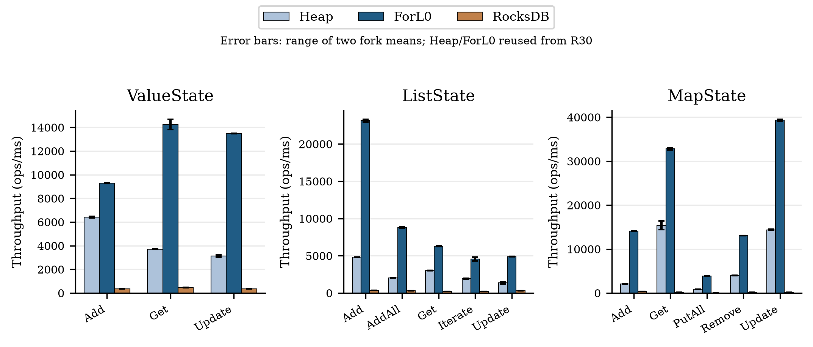

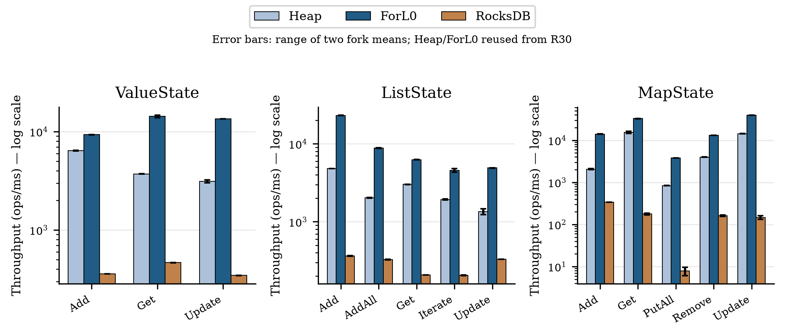

| 标准操作 | Heap ops/ms | ForL0 ops/ms | RocksDB ops/ms | F/H | F/R |
|---|---|---|---|---|---|
| valueAdd | 6,407.15 | 9,289.05 | 358.92 | 1.45× | 25.88× |
| valueGet | 3,717.66 | 14,249.39 | 465.35 | 3.83× | 30.62× |
| valueUpdate | 3,118.82 | 13,480.50 | 344.85 | 4.32× | 39.09× |
| listAdd | 4,829.44 | 23,137.91 | 365.05 | 4.79× | 63.38× |
| listAddAll | 2,036.02 | 8,832.56 | 327.96 | 4.34× | 26.93× |
| listGet | 3,009.07 | 6,264.92 | 208.08 | 2.08× | 30.11× |
| listIterate | 1,931.01 | 4,565.66 | 205.57 | 2.36× | 22.21× |
| listUpdate | 1,350.38 | 4,892.43 | 329.49 | 3.62× | 14.85× |
| mapAdd | 2,057.40 | 14,065.95 | 334.96 | 6.84× | 41.99× |
| mapGet | 15,391.00 | 32,799.26 | 177.40 | 2.13× | 184.89× |
| mapPutAll | 838.31 | 3,837.85 | 7.86 | 4.58× | 488.06× |
| mapRemove | 3,986.18 | 13,086.23 | 160.35 | 3.28× | 81.61× |
| mapUpdate | 14,367.43 | 39,312.93 | 147.03 | 2.74× | 267.38× |

复用的R30微基准中，13项操作的ForL0/Heap均值比为1.45–6.84×。这是相同API/fixture下的操作级结果；主作业只使用Value/Map，List的提升不能解释端到端收益。RocksDB的写维护和共享PVC会影响其操作成本，尤其putAll两fork差异较大，不能用最小吞吐值代表其一般能力。

List get只取得Iterable；iterate读取并求和全部16值；addAll/update为16元素，Map putAll为16对。插入、命中删除及固定列表长度由共同计时外fixture复位，GC/缓存影响可能延续。特别是Heap List add的大部分分配来自fixture的列表重建，不能全部归给计时append。Java分配量和GC MXBean collection time也不等于原生分配或GC线程CPU。

Heap本来就不逐值序列化；ForL0相对Heap的收益不能称为省去其不存在的逐值序列化。RocksDB标准状态调用包含其原有序列化/JNI/KV访问代价，结果对应该API和配置。没有由微基准倍数推断RocksDB端到端表现，本轮也未进行其benchmark set正式比较。

## 8. 适用范围与论文表述边界

- 连续Long实体和feature、无checkpoint、无ForL0 L0的数值状态密集负载是本实验范围；通用序列化、稀疏大key、checkpoint、恢复、TTL、真实生产算法与多机网络均未由此验证。
- R30分页和直接primitive访问减少查找、JNI及对象图更新；Small/dense Map作用于本套作业，List读取缓存只影响List微基准。不能把所有操作级收益叠乘为端到端增益。
- CPU绑定限制可用核，但不提供物理核心独占；宿主机负载与跨日变化仍是效度限制。记录负载、容器CPU throttling及每秒曲线以供复核。
- 原论文重点包含instruction footprint和微架构瓶颈；RSS/PSS是进程内存占用，二者不能混用。未获得PMU实测，本文没有虚构Retiring、Backend Stall或Cache-miss归因。
- 一套有利于ForL0的公平workload能展示目标路径优势，不能代替更广类型/访问模式的外部有效性实验。

分页索引还取决于**单个后端实例**内的key密度：微基准的一个实例管理全部测试key group，端到端则由8个并行实例分担key域。其密度准入规则可能使部分实体回退Swiss表。因此不能仅凭全局key连续就假定端到端全部命中分页路径；实际状态/JNI栈和内存结果用于解释主实验。

## 9. 原始数据、复现与校验

- [执行协议](PROTOCOL.md)、[计划/seed](plan.json)、[逐次CSV](analysis/runs.csv)、[逐条件统计JSON](analysis/conditions.json)。
- [主实验完整分析](analysis/formal-runs.json)、[归因完整分析](analysis/profiles-runs.json)、[微基准fork CSV](analysis/micro-forks.csv)、[微基准完整JSON](analysis/micro-results.json)。
- 每次运行目录包含command、config、flags、job/CP/拓扑、sink/source统计、gzip线程和JVM内存样本、GC日志；profile另含精确窗口JFR、collapsed及HTML火焰图。
- 脚本：`campaign.py`执行，`analyze.py`做窗口对齐与图表，`micro_analysis.py`复用/补充微基准，`build_report.py`生成本文；图同时提供PNG/SVG/PDF。
- [SHA-256清单](MANIFEST.sha256)覆盖交付文件，重跑以冻结工件和显式参数为准，不依赖未提交git工作区的隐含状态。

| workload | GiB/TM | 后端 | 重复 | records/s | 平均PSS GiB | GC CPU s/120s | 原始数据 |
|---|---|---|---|---|---|---|---|
| FD | 32 | forl0 | 1 | 692106.06 | 36.973 | 0.900 | [JSON](formal/fd-m32-forl0-r1/measurement.json) |
| FD | 32 | forl0 | 2 | 710289.41 | 36.969 | 0.872 | [JSON](formal/fd-m32-forl0-r2/measurement.json) |
| FD | 32 | forl0 | 3 | 771724.73 | 36.970 | 0.994 | [JSON](formal/fd-m32-forl0-r3/measurement.json) |
| FD | 32 | heap | 1 | 211259.98 | 26.187 | 472.087 | [JSON](formal/fd-m32-heap-r1/measurement.json) |
| FD | 32 | heap | 2 | 203272.81 | 25.725 | 477.600 | [JSON](formal/fd-m32-heap-r2/measurement.json) |
| FD | 32 | heap | 3 | 209672.29 | 26.042 | 461.552 | [JSON](formal/fd-m32-heap-r3/measurement.json) |
| FD | 40 | forl0 | 1 | 658317.44 | 47.138 | 0.960 | [JSON](formal/fd-m40-forl0-r1/measurement.json) |
| FD | 40 | forl0 | 2 | 540188.28 | 47.098 | 0.930 | [JSON](formal/fd-m40-forl0-r2/measurement.json) |
| FD | 40 | forl0 | 3 | 710195.27 | 47.131 | 0.950 | [JSON](formal/fd-m40-forl0-r3/measurement.json) |
| FD | 40 | heap | 1 | 217926.70 | 27.798 | 450.008 | [JSON](formal/fd-m40-heap-r1/measurement.json) |
| FD | 40 | heap | 2 | 214492.27 | 27.803 | 463.005 | [JSON](formal/fd-m40-heap-r2/measurement.json) |
| FD | 40 | heap | 3 | 223387.93 | 27.896 | 468.999 | [JSON](formal/fd-m40-heap-r3/measurement.json) |
| FD | 48 | forl0 | 1 | 763997.64 | 57.242 | 0.790 | [JSON](formal/fd-m48-forl0-r1/measurement.json) |
| FD | 48 | forl0 | 2 | 742007.94 | 57.248 | 0.730 | [JSON](formal/fd-m48-forl0-r2/measurement.json) |
| FD | 48 | forl0 | 3 | 747402.96 | 57.285 | 0.778 | [JSON](formal/fd-m48-forl0-r3/measurement.json) |
| FD | 48 | heap | 1 | 220318.34 | 26.714 | 448.428 | [JSON](formal/fd-m48-heap-r1/measurement.json) |
| FD | 48 | heap | 2 | 210504.06 | 26.584 | 450.294 | [JSON](formal/fd-m48-heap-r2/measurement.json) |
| FD | 48 | heap | 3 | 214369.02 | 26.602 | 443.133 | [JSON](formal/fd-m48-heap-r3/measurement.json) |
| FD | 56 | forl0 | 1 | 758415.15 | 67.385 | 0.804 | [JSON](formal/fd-m56-forl0-r1/measurement.json) |
| FD | 56 | forl0 | 2 | 700927.11 | 67.417 | 0.714 | [JSON](formal/fd-m56-forl0-r2/measurement.json) |
| FD | 56 | forl0 | 3 | 765842.99 | 67.392 | 0.780 | [JSON](formal/fd-m56-forl0-r3/measurement.json) |
| FD | 56 | heap | 1 | 241796.00 | 26.425 | 441.930 | [JSON](formal/fd-m56-heap-r1/measurement.json) |
| FD | 56 | heap | 2 | 207764.73 | 26.170 | 417.810 | [JSON](formal/fd-m56-heap-r2/measurement.json) |
| FD | 56 | heap | 3 | 227151.84 | 26.296 | 437.857 | [JSON](formal/fd-m56-heap-r3/measurement.json) |
| FD | 64 | forl0 | 1 | 645880.69 | 77.545 | 0.865 | [JSON](formal/fd-m64-forl0-r1/measurement.json) |
| FD | 64 | forl0 | 2 | 752170.85 | 77.504 | 0.960 | [JSON](formal/fd-m64-forl0-r2/measurement.json) |
| FD | 64 | forl0 | 3 | 756344.54 | 77.510 | 0.953 | [JSON](formal/fd-m64-forl0-r3/measurement.json) |
| FD | 64 | heap | 1 | 225512.75 | 27.219 | 429.246 | [JSON](formal/fd-m64-heap-r1/measurement.json) |
| FD | 64 | heap | 2 | 218959.10 | 27.199 | 430.244 | [JSON](formal/fd-m64-heap-r2/measurement.json) |
| FD | 64 | heap | 3 | 226325.89 | 27.297 | 415.722 | [JSON](formal/fd-m64-heap-r3/measurement.json) |
| LG | 32 | forl0 | 1 | 250882.33 | 31.391 | 1.190 | [JSON](formal/lg-m32-forl0-r1/measurement.json) |
| LG | 32 | forl0 | 2 | 255592.85 | 31.403 | 1.219 | [JSON](formal/lg-m32-forl0-r2/measurement.json) |
| LG | 32 | forl0 | 3 | 225518.50 | 31.415 | 1.100 | [JSON](formal/lg-m32-forl0-r3/measurement.json) |
| LG | 32 | heap | 1 | 36578.59 | 36.214 | 447.825 | [JSON](formal/lg-m32-heap-r1/measurement.json) |
| LG | 32 | heap | 2 | 38010.46 | 36.773 | 476.543 | [JSON](formal/lg-m32-heap-r2/measurement.json) |
| LG | 32 | heap | 3 | 40475.96 | 37.767 | 492.742 | [JSON](formal/lg-m32-heap-r3/measurement.json) |
| LG | 40 | forl0 | 1 | 226911.16 | 41.492 | 1.170 | [JSON](formal/lg-m40-forl0-r1/measurement.json) |
| LG | 40 | forl0 | 2 | 230350.06 | 41.566 | 1.180 | [JSON](formal/lg-m40-forl0-r2/measurement.json) |
| LG | 40 | forl0 | 3 | 243293.47 | 41.581 | 1.280 | [JSON](formal/lg-m40-forl0-r3/measurement.json) |
| LG | 40 | heap | 1 | 43863.89 | 42.833 | 506.635 | [JSON](formal/lg-m40-heap-r1/measurement.json) |
| LG | 40 | heap | 2 | 44582.17 | 43.430 | 500.097 | [JSON](formal/lg-m40-heap-r2/measurement.json) |
| LG | 40 | heap | 3 | 44379.84 | 43.071 | 507.806 | [JSON](formal/lg-m40-heap-r3/measurement.json) |
| LG | 48 | forl0 | 1 | 267647.46 | 51.647 | 1.051 | [JSON](formal/lg-m48-forl0-r1/measurement.json) |
| LG | 48 | forl0 | 2 | 270355.73 | 51.645 | 1.031 | [JSON](formal/lg-m48-forl0-r2/measurement.json) |
| LG | 48 | forl0 | 3 | 263345.68 | 51.645 | 1.040 | [JSON](formal/lg-m48-forl0-r3/measurement.json) |
| LG | 48 | heap | 1 | 47359.64 | 42.969 | 454.814 | [JSON](formal/lg-m48-heap-r1/measurement.json) |
| LG | 48 | heap | 2 | 51268.43 | 44.762 | 486.590 | [JSON](formal/lg-m48-heap-r2/measurement.json) |
| LG | 48 | heap | 3 | 48607.04 | 43.654 | 453.860 | [JSON](formal/lg-m48-heap-r3/measurement.json) |
| LG | 56 | forl0 | 1 | 263182.94 | 61.793 | 1.050 | [JSON](formal/lg-m56-forl0-r1/measurement.json) |
| LG | 56 | forl0 | 2 | 240649.53 | 61.771 | 0.980 | [JSON](formal/lg-m56-forl0-r2/measurement.json) |
| LG | 56 | forl0 | 3 | 246365.06 | 61.790 | 0.920 | [JSON](formal/lg-m56-forl0-r3/measurement.json) |
| LG | 56 | heap | 1 | 52985.66 | 44.190 | 468.039 | [JSON](formal/lg-m56-heap-r1/measurement.json) |
| LG | 56 | heap | 2 | 54493.55 | 45.103 | 460.014 | [JSON](formal/lg-m56-heap-r2/measurement.json) |
| LG | 56 | heap | 3 | 50554.38 | 43.450 | 448.018 | [JSON](formal/lg-m56-heap-r3/measurement.json) |
| LG | 64 | forl0 | 1 | 289289.16 | 71.922 | 1.180 | [JSON](formal/lg-m64-forl0-r1/measurement.json) |
| LG | 64 | forl0 | 2 | 233574.26 | 71.907 | 1.080 | [JSON](formal/lg-m64-forl0-r2/measurement.json) |
| LG | 64 | forl0 | 3 | 287894.20 | 71.920 | 1.209 | [JSON](formal/lg-m64-forl0-r3/measurement.json) |
| LG | 64 | heap | 1 | 52934.48 | 43.767 | 424.961 | [JSON](formal/lg-m64-heap-r1/measurement.json) |
| LG | 64 | heap | 2 | 52949.26 | 44.244 | 435.804 | [JSON](formal/lg-m64-heap-r2/measurement.json) |
| LG | 64 | heap | 3 | 54345.04 | 44.596 | 431.467 | [JSON](formal/lg-m64-heap-r3/measurement.json) |
| LR | 32 | forl0 | 1 | 56331.20 | 33.269 | 1.301 | [JSON](formal/lr-m32-forl0-r1/measurement.json) |
| LR | 32 | forl0 | 2 | 54708.09 | 33.270 | 1.270 | [JSON](formal/lr-m32-forl0-r2/measurement.json) |
| LR | 32 | forl0 | 3 | 59227.69 | 33.233 | 1.237 | [JSON](formal/lr-m32-forl0-r3/measurement.json) |
| LR | 32 | heap | 1 | 9387.60 | 42.004 | 519.732 | [JSON](formal/lr-m32-heap-r1/measurement.json) |
| LR | 32 | heap | 2 | 10213.62 | 42.827 | 460.639 | [JSON](formal/lr-m32-heap-r2/measurement.json) |
| LR | 32 | heap | 3 | 10662.33 | 44.044 | 504.083 | [JSON](formal/lr-m32-heap-r3/measurement.json) |
| LR | 40 | forl0 | 1 | 56558.46 | 43.396 | 1.257 | [JSON](formal/lr-m40-forl0-r1/measurement.json) |
| LR | 40 | forl0 | 2 | 58349.11 | 43.425 | 1.357 | [JSON](formal/lr-m40-forl0-r2/measurement.json) |
| LR | 40 | forl0 | 3 | 53236.19 | 43.402 | 1.222 | [JSON](formal/lr-m40-forl0-r3/measurement.json) |
| LR | 40 | heap | 1 | 11259.13 | 52.246 | 477.661 | [JSON](formal/lr-m40-heap-r1/measurement.json) |
| LR | 40 | heap | 2 | 12147.90 | 53.042 | 478.202 | [JSON](formal/lr-m40-heap-r2/measurement.json) |
| LR | 40 | heap | 3 | 11898.85 | 53.597 | 504.857 | [JSON](formal/lr-m40-heap-r3/measurement.json) |
| LR | 48 | forl0 | 1 | 60420.21 | 53.491 | 1.113 | [JSON](formal/lr-m48-forl0-r1/measurement.json) |
| LR | 48 | forl0 | 2 | 60781.46 | 53.481 | 1.098 | [JSON](formal/lr-m48-forl0-r2/measurement.json) |
| LR | 48 | forl0 | 3 | 63132.68 | 53.478 | 1.151 | [JSON](formal/lr-m48-forl0-r3/measurement.json) |
| LR | 48 | heap | 1 | 12834.18 | 54.674 | 473.288 | [JSON](formal/lr-m48-heap-r1/measurement.json) |
| LR | 48 | heap | 2 | 13626.06 | 54.547 | 441.668 | [JSON](formal/lr-m48-heap-r2/measurement.json) |
| LR | 48 | heap | 3 | 13797.34 | 54.390 | 437.898 | [JSON](formal/lr-m48-heap-r3/measurement.json) |
| LR | 56 | forl0 | 1 | 62374.85 | 63.584 | 1.070 | [JSON](formal/lr-m56-forl0-r1/measurement.json) |
| LR | 56 | forl0 | 2 | 56706.46 | 63.608 | 1.040 | [JSON](formal/lr-m56-forl0-r2/measurement.json) |
| LR | 56 | forl0 | 3 | 62408.82 | 63.608 | 1.120 | [JSON](formal/lr-m56-forl0-r3/measurement.json) |
| LR | 56 | heap | 1 | 14869.24 | 56.184 | 432.193 | [JSON](formal/lr-m56-heap-r1/measurement.json) |
| LR | 56 | heap | 2 | 14282.04 | 55.543 | 434.538 | [JSON](formal/lr-m56-heap-r2/measurement.json) |
| LR | 56 | heap | 3 | 14570.87 | 55.694 | 432.328 | [JSON](formal/lr-m56-heap-r3/measurement.json) |
| LR | 64 | forl0 | 1 | 70387.50 | 73.748 | 1.329 | [JSON](formal/lr-m64-forl0-r1/measurement.json) |
| LR | 64 | forl0 | 2 | 55986.51 | 73.819 | 1.061 | [JSON](formal/lr-m64-forl0-r2/measurement.json) |
| LR | 64 | forl0 | 3 | 63249.11 | 73.767 | 1.233 | [JSON](formal/lr-m64-forl0-r3/measurement.json) |
| LR | 64 | heap | 1 | 14731.43 | 55.486 | 423.010 | [JSON](formal/lr-m64-heap-r1/measurement.json) |
| LR | 64 | heap | 2 | 15366.07 | 56.526 | 423.613 | [JSON](formal/lr-m64-heap-r2/measurement.json) |
| LR | 64 | heap | 3 | 14991.47 | 56.201 | 436.389 | [JSON](formal/lr-m64-heap-r3/measurement.json) |
| SD | 32 | forl0 | 1 | 470462.65 | 30.998 | 1.070 | [JSON](formal/sd-m32-forl0-r1/measurement.json) |
| SD | 32 | forl0 | 2 | 470560.21 | 30.960 | 1.120 | [JSON](formal/sd-m32-forl0-r2/measurement.json) |
| SD | 32 | forl0 | 3 | 481517.96 | 30.944 | 1.059 | [JSON](formal/sd-m32-forl0-r3/measurement.json) |
| SD | 32 | heap | 1 | 91998.98 | 29.342 | 492.609 | [JSON](formal/sd-m32-heap-r1/measurement.json) |
| SD | 32 | heap | 2 | 85393.18 | 27.907 | 462.502 | [JSON](formal/sd-m32-heap-r2/measurement.json) |
| SD | 32 | heap | 3 | 97486.27 | 31.274 | 507.563 | [JSON](formal/sd-m32-heap-r3/measurement.json) |
| SD | 40 | forl0 | 1 | 415213.47 | 41.086 | 1.090 | [JSON](formal/sd-m40-forl0-r1/measurement.json) |
| SD | 40 | forl0 | 2 | 406598.11 | 41.123 | 1.100 | [JSON](formal/sd-m40-forl0-r2/measurement.json) |
| SD | 40 | forl0 | 3 | 406357.21 | 41.134 | 1.260 | [JSON](formal/sd-m40-forl0-r3/measurement.json) |
| SD | 40 | heap | 1 | 107159.32 | 31.822 | 503.604 | [JSON](formal/sd-m40-heap-r1/measurement.json) |
| SD | 40 | heap | 2 | 105515.05 | 31.557 | 488.276 | [JSON](formal/sd-m40-heap-r2/measurement.json) |
| SD | 40 | heap | 3 | 105191.55 | 31.272 | 480.745 | [JSON](formal/sd-m40-heap-r3/measurement.json) |
| SD | 48 | forl0 | 1 | 469644.28 | 51.192 | 0.891 | [JSON](formal/sd-m48-forl0-r1/measurement.json) |
| SD | 48 | forl0 | 2 | 542762.89 | 51.185 | 1.017 | [JSON](formal/sd-m48-forl0-r2/measurement.json) |
| SD | 48 | forl0 | 3 | 552852.92 | 51.263 | 0.980 | [JSON](formal/sd-m48-forl0-r3/measurement.json) |
| SD | 48 | heap | 1 | 126957.62 | 32.979 | 514.008 | [JSON](formal/sd-m48-heap-r1/measurement.json) |
| SD | 48 | heap | 2 | 108746.62 | 30.566 | 474.189 | [JSON](formal/sd-m48-heap-r2/measurement.json) |
| SD | 48 | heap | 3 | 116708.71 | 31.463 | 491.097 | [JSON](formal/sd-m48-heap-r3/measurement.json) |
| SD | 56 | forl0 | 1 | 427143.03 | 61.339 | 0.820 | [JSON](formal/sd-m56-forl0-r1/measurement.json) |
| SD | 56 | forl0 | 2 | 532729.22 | 61.337 | 0.920 | [JSON](formal/sd-m56-forl0-r2/measurement.json) |
| SD | 56 | forl0 | 3 | 547680.31 | 61.419 | 1.033 | [JSON](formal/sd-m56-forl0-r3/measurement.json) |
| SD | 56 | heap | 1 | 107962.16 | 29.702 | 478.459 | [JSON](formal/sd-m56-heap-r1/measurement.json) |
| SD | 56 | heap | 2 | 120437.51 | 31.166 | 496.868 | [JSON](formal/sd-m56-heap-r2/measurement.json) |
| SD | 56 | heap | 3 | 110736.34 | 30.088 | 472.792 | [JSON](formal/sd-m56-heap-r3/measurement.json) |
| SD | 64 | forl0 | 1 | 459249.10 | 71.473 | 1.002 | [JSON](formal/sd-m64-forl0-r1/measurement.json) |
| SD | 64 | forl0 | 2 | 455869.20 | 71.525 | 1.120 | [JSON](formal/sd-m64-forl0-r2/measurement.json) |
| SD | 64 | forl0 | 3 | 465270.48 | 71.503 | 0.972 | [JSON](formal/sd-m64-forl0-r3/measurement.json) |
| SD | 64 | heap | 1 | 107479.04 | 29.043 | 459.457 | [JSON](formal/sd-m64-heap-r1/measurement.json) |
| SD | 64 | heap | 2 | 112749.82 | 29.290 | 465.312 | [JSON](formal/sd-m64-heap-r2/measurement.json) |
| SD | 64 | heap | 3 | 109969.65 | 29.225 | 478.090 | [JSON](formal/sd-m64-heap-r3/measurement.json) |
| TM | 32 | forl0 | 1 | 468377.88 | 30.454 | 1.010 | [JSON](formal/tm-m32-forl0-r1/measurement.json) |
| TM | 32 | forl0 | 2 | 465986.05 | 30.471 | 1.045 | [JSON](formal/tm-m32-forl0-r2/measurement.json) |
| TM | 32 | forl0 | 3 | 504506.28 | 30.484 | 1.099 | [JSON](formal/tm-m32-forl0-r3/measurement.json) |
| TM | 32 | heap | 1 | 103480.55 | 30.888 | 512.809 | [JSON](formal/tm-m32-heap-r1/measurement.json) |
| TM | 32 | heap | 2 | 92971.44 | 28.924 | 492.307 | [JSON](formal/tm-m32-heap-r2/measurement.json) |
| TM | 32 | heap | 3 | 102242.24 | 30.672 | 501.726 | [JSON](formal/tm-m32-heap-r3/measurement.json) |
| TM | 40 | forl0 | 1 | 445485.33 | 40.637 | 1.180 | [JSON](formal/tm-m40-forl0-r1/measurement.json) |
| TM | 40 | forl0 | 2 | 482699.96 | 40.634 | 1.138 | [JSON](formal/tm-m40-forl0-r2/measurement.json) |
| TM | 40 | forl0 | 3 | 468470.79 | 40.602 | 1.186 | [JSON](formal/tm-m40-forl0-r3/measurement.json) |
| TM | 40 | heap | 1 | 102675.73 | 30.011 | 479.333 | [JSON](formal/tm-m40-heap-r1/measurement.json) |
| TM | 40 | heap | 2 | 118847.48 | 32.741 | 510.396 | [JSON](formal/tm-m40-heap-r2/measurement.json) |
| TM | 40 | heap | 3 | 113024.87 | 31.623 | 487.575 | [JSON](formal/tm-m40-heap-r3/measurement.json) |
| TM | 48 | forl0 | 1 | 475046.95 | 50.712 | 0.880 | [JSON](formal/tm-m48-forl0-r1/measurement.json) |
| TM | 48 | forl0 | 2 | 465941.45 | 50.717 | 0.920 | [JSON](formal/tm-m48-forl0-r2/measurement.json) |
| TM | 48 | forl0 | 3 | 505707.97 | 50.727 | 0.940 | [JSON](formal/tm-m48-forl0-r3/measurement.json) |
| TM | 48 | heap | 1 | 124385.09 | 31.780 | 502.019 | [JSON](formal/tm-m48-heap-r1/measurement.json) |
| TM | 48 | heap | 2 | 112572.98 | 30.769 | 473.874 | [JSON](formal/tm-m48-heap-r2/measurement.json) |
| TM | 48 | heap | 3 | 117195.52 | 30.918 | 476.015 | [JSON](formal/tm-m48-heap-r3/measurement.json) |
| TM | 56 | forl0 | 1 | 463784.22 | 60.827 | 0.913 | [JSON](formal/tm-m56-forl0-r1/measurement.json) |
| TM | 56 | forl0 | 2 | 466234.03 | 60.888 | 0.864 | [JSON](formal/tm-m56-forl0-r2/measurement.json) |
| TM | 56 | forl0 | 3 | 512592.94 | 60.847 | 0.870 | [JSON](formal/tm-m56-forl0-r3/measurement.json) |
| TM | 56 | heap | 1 | 115901.51 | 29.261 | 466.966 | [JSON](formal/tm-m56-heap-r1/measurement.json) |
| TM | 56 | heap | 2 | 115266.49 | 29.572 | 479.110 | [JSON](formal/tm-m56-heap-r2/measurement.json) |
| TM | 56 | heap | 3 | 120979.41 | 30.288 | 474.667 | [JSON](formal/tm-m56-heap-r3/measurement.json) |
| TM | 64 | forl0 | 1 | 466232.53 | 71.012 | 1.058 | [JSON](formal/tm-m64-forl0-r1/measurement.json) |
| TM | 64 | forl0 | 2 | 502338.20 | 70.997 | 1.047 | [JSON](formal/tm-m64-forl0-r2/measurement.json) |
| TM | 64 | forl0 | 3 | 413692.08 | 71.032 | 0.912 | [JSON](formal/tm-m64-forl0-r3/measurement.json) |
| TM | 64 | heap | 1 | 126750.75 | 29.712 | 464.203 | [JSON](formal/tm-m64-heap-r1/measurement.json) |
| TM | 64 | heap | 2 | 124029.61 | 29.477 | 463.819 | [JSON](formal/tm-m64-heap-r2/measurement.json) |
| TM | 64 | heap | 3 | 125567.84 | 29.687 | 469.007 | [JSON](formal/tm-m64-heap-r3/measurement.json) |
| VS | 32 | forl0 | 1 | 44341.79 | 33.723 | 1.363 | [JSON](formal/vs-m32-forl0-r1/measurement.json) |
| VS | 32 | forl0 | 2 | 44206.86 | 33.732 | 1.320 | [JSON](formal/vs-m32-forl0-r2/measurement.json) |
| VS | 32 | forl0 | 3 | 46520.44 | 33.717 | 1.385 | [JSON](formal/vs-m32-forl0-r3/measurement.json) |
| VS | 32 | heap | 1 | 6166.56 | 43.638 | 549.660 | [JSON](formal/vs-m32-heap-r1/measurement.json) |
| VS | 32 | heap | 2 | 6346.60 | 43.443 | 554.613 | [JSON](formal/vs-m32-heap-r2/measurement.json) |
| VS | 32 | heap | 3 | 6098.40 | 43.209 | 598.507 | [JSON](formal/vs-m32-heap-r3/measurement.json) |
| VS | 40 | forl0 | 1 | 41951.02 | 43.852 | 1.360 | [JSON](formal/vs-m40-forl0-r1/measurement.json) |
| VS | 40 | forl0 | 2 | 42577.30 | 43.843 | 1.310 | [JSON](formal/vs-m40-forl0-r2/measurement.json) |
| VS | 40 | forl0 | 3 | 39755.12 | 43.879 | 1.344 | [JSON](formal/vs-m40-forl0-r3/measurement.json) |
| VS | 40 | heap | 1 | 8122.75 | 57.078 | 517.641 | [JSON](formal/vs-m40-heap-r1/measurement.json) |
| VS | 40 | heap | 2 | 8400.52 | 57.576 | 491.820 | [JSON](formal/vs-m40-heap-r2/measurement.json) |
| VS | 40 | heap | 3 | 7886.62 | 56.028 | 498.480 | [JSON](formal/vs-m40-heap-r3/measurement.json) |
| VS | 48 | forl0 | 1 | 42264.50 | 54.064 | 1.076 | [JSON](formal/vs-m48-forl0-r1/measurement.json) |
| VS | 48 | forl0 | 2 | 51345.67 | 53.954 | 1.290 | [JSON](formal/vs-m48-forl0-r2/measurement.json) |
| VS | 48 | forl0 | 3 | 46100.60 | 54.055 | 1.180 | [JSON](formal/vs-m48-forl0-r3/measurement.json) |
| VS | 48 | heap | 1 | 8206.64 | 56.463 | 461.652 | [JSON](formal/vs-m48-heap-r1/measurement.json) |
| VS | 48 | heap | 2 | 8954.63 | 58.997 | 493.060 | [JSON](formal/vs-m48-heap-r2/measurement.json) |
| VS | 48 | heap | 3 | 8992.51 | 58.569 | 480.539 | [JSON](formal/vs-m48-heap-r3/measurement.json) |
| VS | 56 | forl0 | 1 | 51944.78 | 64.119 | 1.161 | [JSON](formal/vs-m56-forl0-r1/measurement.json) |
| VS | 56 | forl0 | 2 | 46927.86 | 64.120 | 1.156 | [JSON](formal/vs-m56-forl0-r2/measurement.json) |
| VS | 56 | forl0 | 3 | 48894.64 | 64.105 | 1.275 | [JSON](formal/vs-m56-forl0-r3/measurement.json) |
| VS | 56 | heap | 1 | 10322.81 | 59.552 | 453.164 | [JSON](formal/vs-m56-heap-r1/measurement.json) |
| VS | 56 | heap | 2 | 10504.36 | 60.761 | 470.429 | [JSON](formal/vs-m56-heap-r2/measurement.json) |
| VS | 56 | heap | 3 | 10186.72 | 59.085 | 434.045 | [JSON](formal/vs-m56-heap-r3/measurement.json) |
| VS | 64 | forl0 | 1 | 51565.74 | 74.314 | 1.260 | [JSON](formal/vs-m64-forl0-r1/measurement.json) |
| VS | 64 | forl0 | 2 | 43572.27 | 74.250 | 1.182 | [JSON](formal/vs-m64-forl0-r2/measurement.json) |
| VS | 64 | forl0 | 3 | 40660.33 | 74.232 | 1.113 | [JSON](formal/vs-m64-forl0-r3/measurement.json) |
| VS | 64 | heap | 1 | 10591.69 | 59.812 | 418.278 | [JSON](formal/vs-m64-heap-r1/measurement.json) |
| VS | 64 | heap | 2 | 10865.34 | 60.526 | 432.144 | [JSON](formal/vs-m64-heap-r2/measurement.json) |
| VS | 64 | heap | 3 | 10968.98 | 60.460 | 429.921 | [JSON](formal/vs-m64-heap-r3/measurement.json) |
| WC | 32 | forl0 | 1 | 884192.71 | 30.043 | 1.048 | [JSON](formal/wc-m32-forl0-r1/measurement.json) |
| WC | 32 | forl0 | 2 | 871796.56 | 30.001 | 1.083 | [JSON](formal/wc-m32-forl0-r2/measurement.json) |
| WC | 32 | forl0 | 3 | 814862.14 | 30.032 | 0.950 | [JSON](formal/wc-m32-forl0-r3/measurement.json) |
| WC | 32 | heap | 1 | 223379.23 | 19.783 | 481.320 | [JSON](formal/wc-m32-heap-r1/measurement.json) |
| WC | 32 | heap | 2 | 207670.52 | 19.053 | 457.659 | [JSON](formal/wc-m32-heap-r2/measurement.json) |
| WC | 32 | heap | 3 | 214489.98 | 19.411 | 467.283 | [JSON](formal/wc-m32-heap-r3/measurement.json) |
| WC | 40 | forl0 | 1 | 751784.53 | 40.155 | 1.110 | [JSON](formal/wc-m40-forl0-r1/measurement.json) |
| WC | 40 | forl0 | 2 | 822177.27 | 40.164 | 1.140 | [JSON](formal/wc-m40-forl0-r2/measurement.json) |
| WC | 40 | forl0 | 3 | 846217.08 | 40.149 | 1.070 | [JSON](formal/wc-m40-forl0-r3/measurement.json) |
| WC | 40 | heap | 1 | 224328.15 | 17.675 | 453.978 | [JSON](formal/wc-m40-heap-r1/measurement.json) |
| WC | 40 | heap | 2 | 224296.36 | 17.777 | 462.259 | [JSON](formal/wc-m40-heap-r2/measurement.json) |
| WC | 40 | heap | 3 | 233765.17 | 18.062 | 462.062 | [JSON](formal/wc-m40-heap-r3/measurement.json) |
| WC | 48 | forl0 | 1 | 909315.89 | 50.237 | 0.940 | [JSON](formal/wc-m48-forl0-r1/measurement.json) |
| WC | 48 | forl0 | 2 | 922949.73 | 50.250 | 0.946 | [JSON](formal/wc-m48-forl0-r2/measurement.json) |
| WC | 48 | forl0 | 3 | 883238.04 | 50.270 | 0.870 | [JSON](formal/wc-m48-forl0-r3/measurement.json) |
| WC | 48 | heap | 1 | 248241.00 | 16.745 | 468.066 | [JSON](formal/wc-m48-heap-r1/measurement.json) |
| WC | 48 | heap | 2 | 219246.38 | 16.255 | 442.669 | [JSON](formal/wc-m48-heap-r2/measurement.json) |
| WC | 48 | heap | 3 | 237284.28 | 16.508 | 446.872 | [JSON](formal/wc-m48-heap-r3/measurement.json) |
| WC | 56 | forl0 | 1 | 897065.28 | 60.435 | 0.930 | [JSON](formal/wc-m56-forl0-r1/measurement.json) |
| WC | 56 | forl0 | 2 | 899353.95 | 60.432 | 0.800 | [JSON](formal/wc-m56-forl0-r2/measurement.json) |
| WC | 56 | forl0 | 3 | 915744.68 | 60.403 | 0.920 | [JSON](formal/wc-m56-forl0-r3/measurement.json) |
| WC | 56 | heap | 1 | 237807.22 | 16.096 | 452.737 | [JSON](formal/wc-m56-heap-r1/measurement.json) |
| WC | 56 | heap | 2 | 250013.57 | 16.162 | 451.820 | [JSON](formal/wc-m56-heap-r2/measurement.json) |
| WC | 56 | heap | 3 | 239741.62 | 16.091 | 455.185 | [JSON](formal/wc-m56-heap-r3/measurement.json) |
| WC | 64 | forl0 | 1 | 904862.64 | 70.558 | 0.984 | [JSON](formal/wc-m64-forl0-r1/measurement.json) |
| WC | 64 | forl0 | 2 | 917188.02 | 70.550 | 0.982 | [JSON](formal/wc-m64-forl0-r2/measurement.json) |
| WC | 64 | forl0 | 3 | 916162.07 | 70.564 | 1.029 | [JSON](formal/wc-m64-forl0-r3/measurement.json) |
| WC | 64 | heap | 1 | 227056.43 | 16.684 | 430.385 | [JSON](formal/wc-m64-heap-r1/measurement.json) |
| WC | 64 | heap | 2 | 242514.42 | 16.723 | 448.366 | [JSON](formal/wc-m64-heap-r2/measurement.json) |
| WC | 64 | heap | 3 | 239145.39 | 16.743 | 448.323 | [JSON](formal/wc-m64-heap-r3/measurement.json) |

## 10. 参考资料

1. Zhang et al. *Revisiting the Design of Data Stream Processing Systems on Multi-Core Processors*. ICDE2017，DOI10.1109/ICDE.2017.119。[原文PDF](https://www.comp.nus.edu.sg/~hebs/pub/shuhaoICDE17a.pdf)。
2. Apache Flink1.20.3 [State Backends](https://nightlies.apache.org/flink/flink-docs-release-1.20/docs/ops/state/state_backends/)。
3. Apache Flink1.20.3 [TaskManager Memory](https://nightlies.apache.org/flink/flink-docs-release-1.20/docs/deployment/memory/mem_setup_tm/)。

